**English** | [简体中文](README.md)

<div align="center">

# Financial Freedom Planner

**A local-first financial-freedom planner based on the 480 Rule · Pure front-end · Rust → WebAssembly · Nothing uploaded**

[](https://react.dev)
[](https://rustwasm.github.io/)
[](#-features)

*Inspiration: the video 《你需要多少钱，才能财富自由？》 ("How much money do you need to be financially free?", 2026-10) · [▶ Watch the original](https://www.bilibili.com/video/BV1yUHP6rEYD/)*

</div>

> [!IMPORTANT]
> **This project is for learning and personal planning reference only. It is not a financial product, not investment advisory services, and not licensed consulting.**
> This repository is a **learning implementation** of the idea presented in the video above, built to practice Rust/WASM, React and front-end engineering — it is not an investment product, offers no investment advice, and is not affiliated with the video's original publisher.

> [!WARNING]
> **Every output of this tool is the result of a simplified mathematical model** and may deviate from current policy or precise conventions. It **does not constitute investment, tax or legal advice**. Verify against official sources and consult licensed professionals before making any real-world decision.

> [!CAUTION]
> The bundled data (tax tables, rental yields, exchange rates, etc.) is a **snapshot of public data as of writing/verification** (mostly 2024–2025 conventions, verified 2026-11). Tax rules and market data change at any time. Always check the source and year annotated on screen; do not treat it as up-to-date authoritative data.

> [!NOTE]
> All computation runs locally in the browser (Rust → WebAssembly). **Nothing is uploaded or collected.** Share-link content is reversible encoding (encoding ≠ encryption): anyone holding the link can read every business input — do not carry numbers you would not share. Basic calculations work fully offline (except live exchange rates for the multi-currency panel — see "Known Limitations").

---

## 📖 What this project is

The core is a "480 Rule" baseline — a popular simplified model from the video (**not an academic result**):

```
Critical value = (12 ÷ real return rate) × monthly expense + child-raising cost + health reserve + major investment
Real return rate = nominal return rate − inflation rate   (defaults: 4.5% − 2.0% = 2.5% → multiplier 480)
```

With the default inputs (monthly expense 2,990 yuan, organized from the official urban per-capita consumer spending statistics), the reference line is about **1.635 million CNY** (parallel reference: the exact Fisher-basis multiplier is 489.6 → about 1.664 million CNY; both calibers are shown side by side in the panel). Any input change re-computes instantly.

The advanced estimates section uses a **segmented-control + per-group tabs** navigation (nine sub-panels grouped into three segments: Life planning / Housing & loans / Analysis tools; a single on-screen focus, with running simulation results and form inputs preserved across group switches, and arrow keys roaming within a group's tabs) and adds: reverse estimation, a loan calculator, buy-and-rent-out analysis, Monte Carlo simulation (return mode: normal parameters or historical bootstrap; withdrawal strategy: fixed real spending (default) / threshold-band adjustment / percentage of balance, with a deterministic sequence-risk comparison built into the panel), public-pension estimation, tax estimation with a multi-currency check, the work-years simulation (which can also back-solve the required monthly saving for a target horizon), and the multi-scenario comparison (a browser-local scenario library with side-by-side key-metric comparison); the base output card expands into a "Monthly-expense sensitivity" section (reference lines at ±10% / ±20% / ±30%), and "Copy share link" encodes all business inputs into the URL — opening the link restores the same parameter set. The app installs to the desktop / home screen as a PWA and works offline once installed — all computation still stays local.

## 📸 Demo

> Everything below is a **real running capture**: actual screenshots of this repository's build output — not mockups or hand-drawn designs.

<div align="center">

### Desktop two-column workbench · Reading on the left, tools on the right

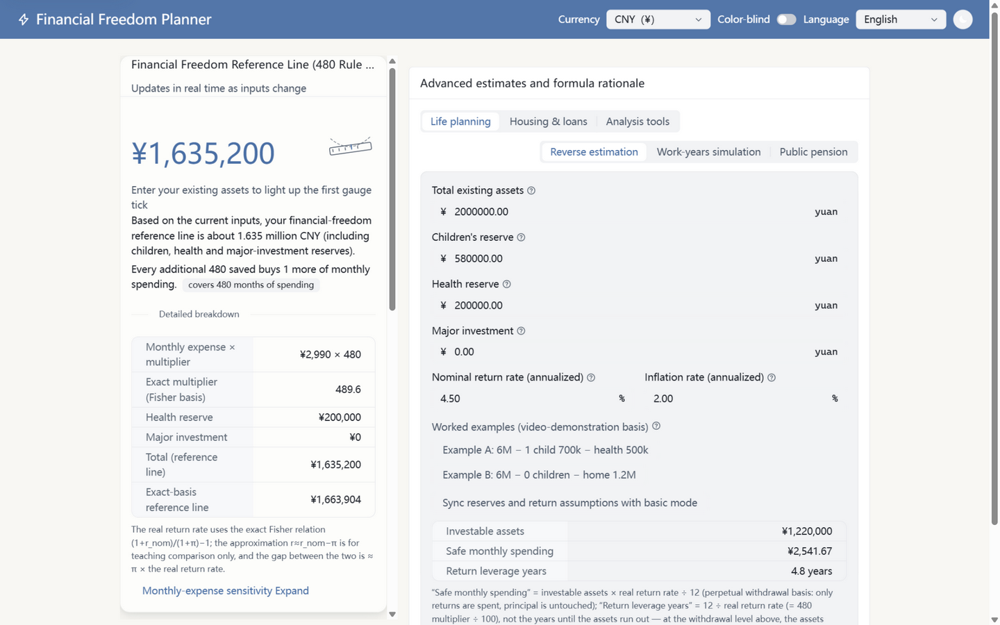

*Desktop two-column layout (active at ≥1200 px viewports; single column below the breakpoint): the left column keeps the "480 Rule" baseline output card — the large critical value, the detailed breakdown (with the parallel exact Fisher-basis rows: exact multiplier 489.6 / exact-basis reference line ¥1,663,904) and the monthly-expense-sensitivity entry (the ruler art at the upper right is the empty state before assets are filled in; it becomes the progress ring afterwards); the right column hosts "Advanced estimates and formula rationale", navigated by a segmented control (Life planning / Housing & loans / Analysis tools) plus in-group tabs, currently on Reverse estimation with its worked examples and the ¥1,220,000 / ¥2,541.67 / 4.8 years result rows*

### Workbench flow · Two-column linkage and state kept across panels

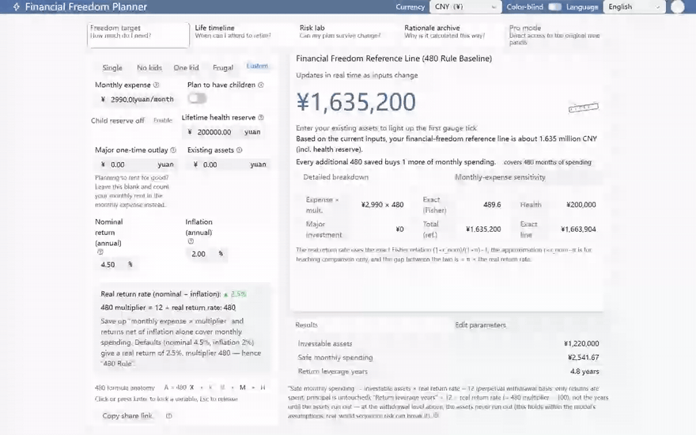

*Typing in the left column (monthly expense → 3,500): the large critical value settles at ¥1,880,000 with an asymptotic roll of ~360 ms, the breakdown updates to ¥3,500 × 480 and the parallel exact Fisher-basis line to ¥1,913,600; on the right, the Public pension panel takes "Age you plan to stop working = 55" and the bridge card reports 5 years / ¥1,680,000 (= 3,500 × 480 on the full living-expense basis, following the left column's expense), with the "Adjusted reference line (after pension payments start)" moving to ¥657.97 / ¥515,825.6; the Work-years simulation then runs (sustainability check years 10) and yields the dual-metric card — a 99.5% probability of reaching the goal alongside a 99.5% sustained success probability — the two columns scroll independently and no state is lost across panel switches*

### Basic calculation · Live recomputation while typing

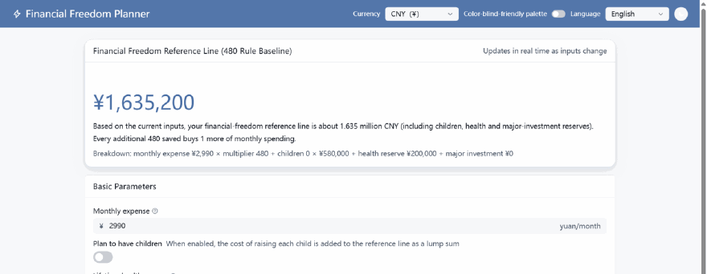

*Typing into "Monthly expense" (2,990 → 5,600 → 8,000): the large critical value, the "million CNY" conversion line and the breakdown update in real time; the large figure transitions with an asymptotic roll of ~360 ms (the recording is cut before it settles — per the final frame's breakdown, ¥8,000 × 480 + ¥200,000, it settles at ¥4,040,000)*

### Monte Carlo simulation · 5,000 paths in one click

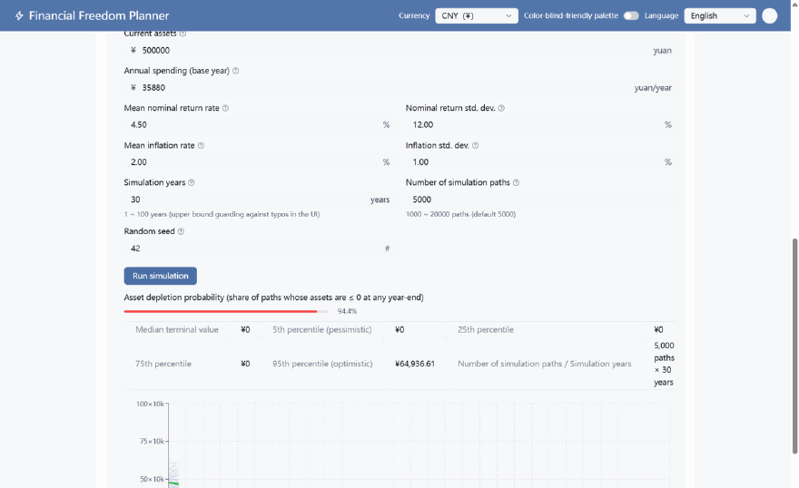

*Click "Run simulation" and the compute core runs 5,000 paths × 30 years entirely locally in the browser. Changing the random seed from 42 to 2024 and re-running: depletion probability 94.4% → 94.2%, 95th percentile ¥64,936.61 → ¥77,407.18 — same seed + same inputs → fully reproducible (noted in the panel as guaranteed by contract)*

### Color-blind-friendly palette · One-click switch

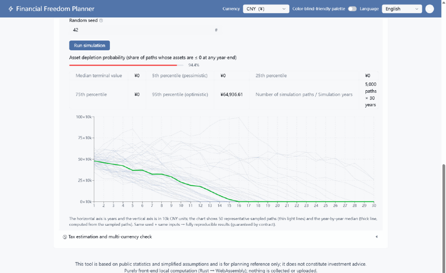

*With the palette on, semantic colors switch to a high-separation blue/orange pair: the median curve turns from green to blue and the depletion bar from red to orange; inputs, the seed (42) and every percentile value stay unchanged*

</div>

| ⑦ Public pension · How much you can draw, and how much lower the line gets | Monte Carlo · Historical bootstrap |
| --- | --- |
| 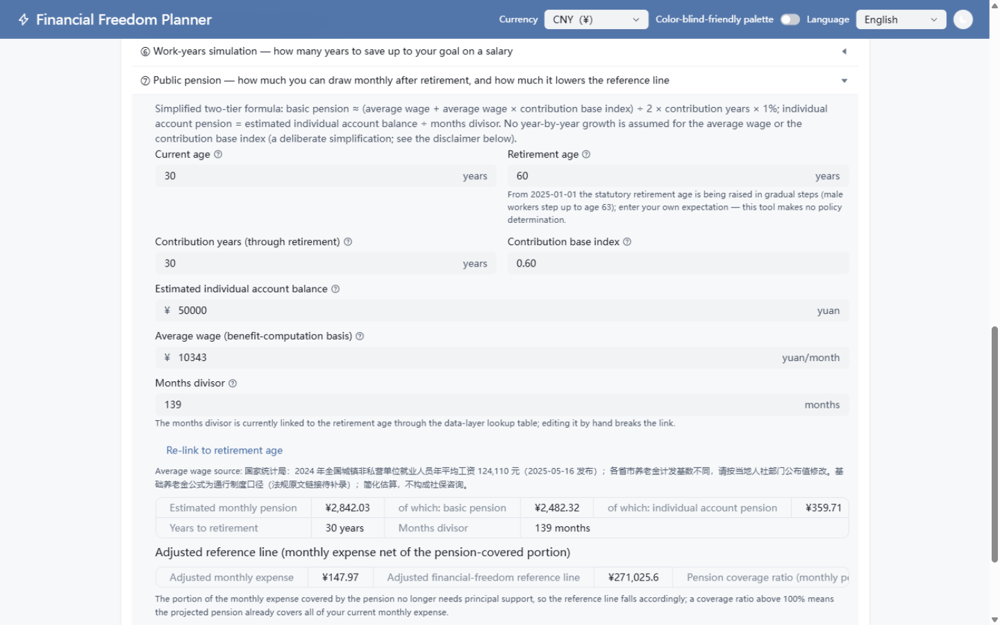 | 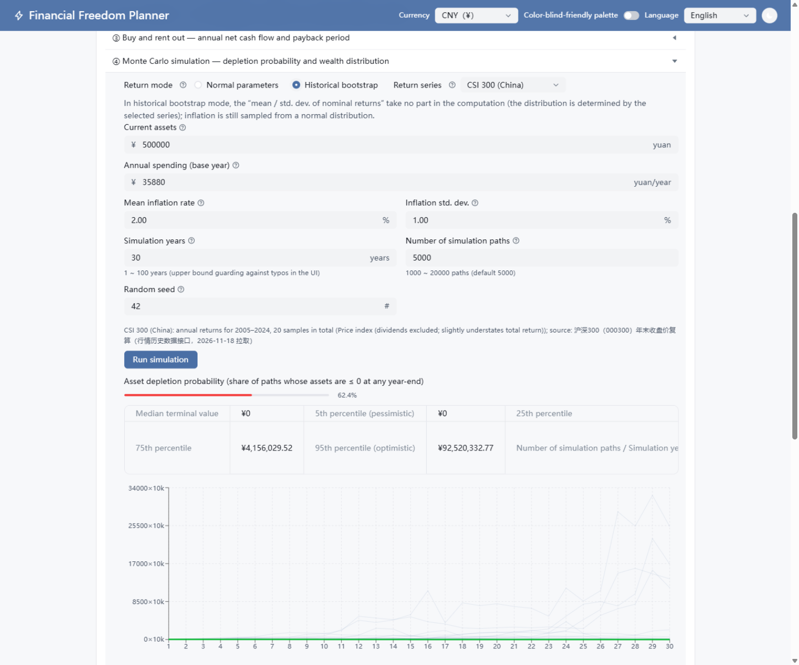 |
| *Panel ⑦ with defaults (age 30, retiring at 60, 30 contribution years, base index 0.6, account balance 50k, average wage 10,343, months divisor 139): expected monthly pension ¥2,842.03 (basic ¥2,482.32 + individual account ¥359.71), coverage ratio 95%; adjusted monthly expense ¥147.97, adjusted reference line ¥271,025.6 — that figure is the **after-claiming** (segment 2) caliber (including the one-off 200k health reserve); the 30–60 bridge period (stop work → claiming) needs another **1.435 million CNY** on the living-expense caliber (2,990 × 480 = 1,435,200 — enter "Age you plan to stop working = 30" in the panel to see it); one-off reserves are already counted in the "after claiming" line and are not double-counted in the bridge segment, and **the two segments add up to 1.706 million CNY = the true total requirement**; a fixed "simplified estimate, not social-security advice" notice stays at the bottom of the panel* | *Switching the return mode to "historical bootstrap" (series: CSI 300, 20 annual returns for 2005–2024, price index) hides the nominal-return mean/std fields with a note that they take no part in the computation; running with the same inputs and seed 42 → asset depletion probability 62.4%, median terminal value ¥0, 75th percentile ¥4,156,029.52, 95th percentile ¥92,520,332.77 (the normal-parameter mode gives 94.4% on the same inputs — see the annotated capture below); same seed + same inputs are fully reproducible (guaranteed by contract)* |

| Monte Carlo · withdrawal strategy (threshold-band run) | Sequence-risk comparison · rolling-start fate curves |
| --- | --- |
| 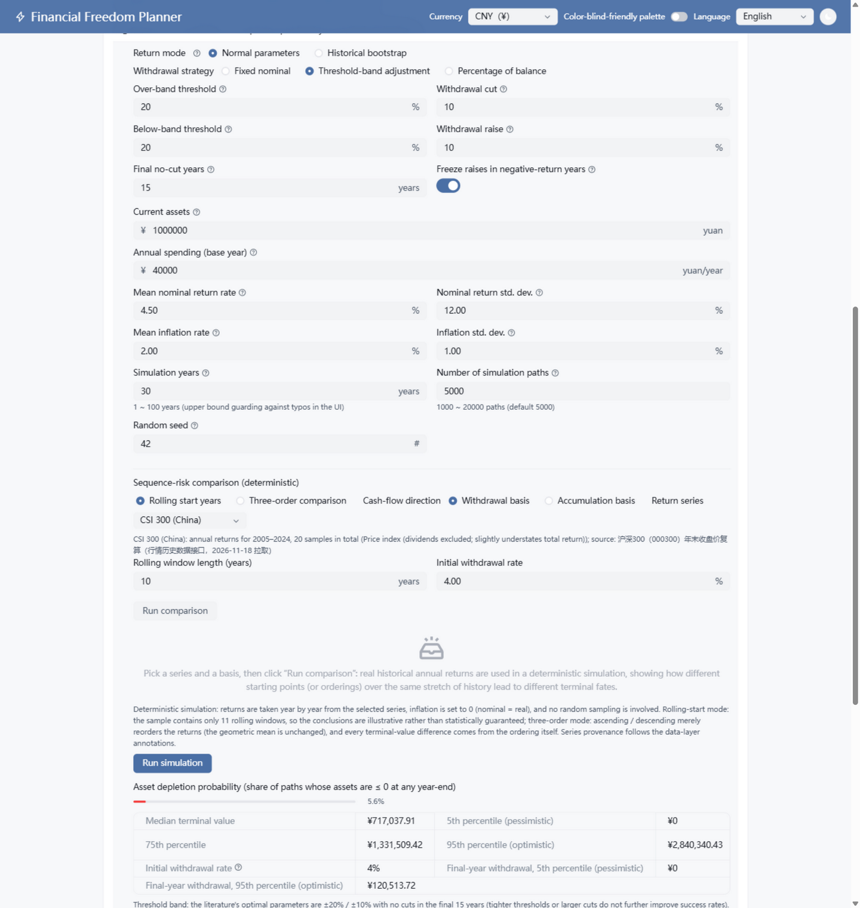 | 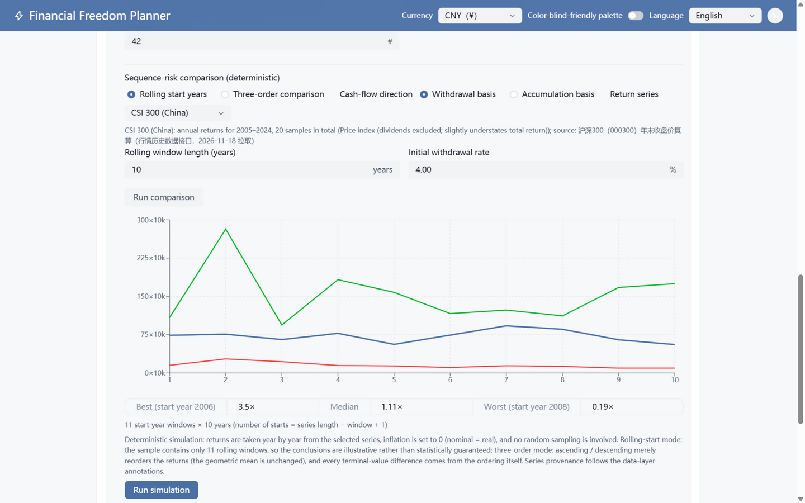 |
| *Withdrawal strategy set to "Threshold-band adjustment" (defaults: over-band threshold 20% / withdrawal cut 10% / below-band threshold 20% / withdrawal raise 10% / no cuts in the final 15 years / freeze-on-loss on): current assets ¥1,000,000, annual spending ¥40,000 (initial withdrawal rate 4%), nominal return 4.5% ± 12%, inflation 2% ± 1%, 30 years, 5,000 paths, seed 42 → asset depletion probability 5.6%; the result rows add "Initial withdrawal rate" and the final-year withdrawal percentiles (5th ¥0 / 95th ¥120,513.72); below, the sequence-risk sub-section still shows the empty component with its guidance copy while not yet run* | *The "Sequence-risk comparison (deterministic)" sub-section running rolling start years: withdrawal basis, CSI 300 (20 annual returns for 2005–2024), window length 10 years, initial withdrawal rate 4% → three fate curves, Best (start year 2006) 3.5× / Median 1.11× / Worst (start year 2008) 0.19×; "11 start-year windows × 10 years" is annotated below, and the convention note states that inflation is set to 0 (nominal = real) and that the limited number of windows keeps the conclusions illustrative* |

| ⑧ Multi-scenario comparison · side by side from the scenario library | Work-years simulation · back-solve savings mode (panel ⑥) |
| --- | --- |
| 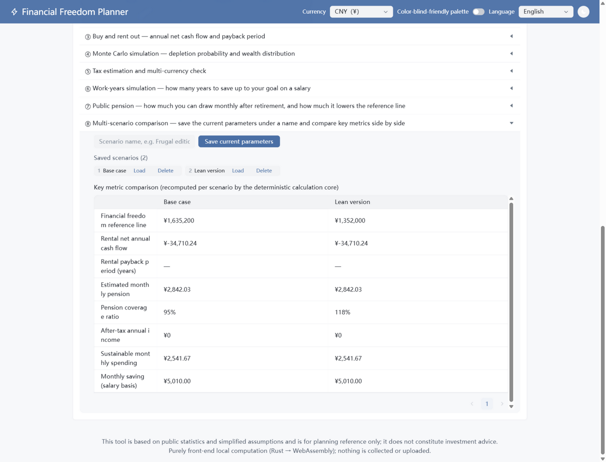 | 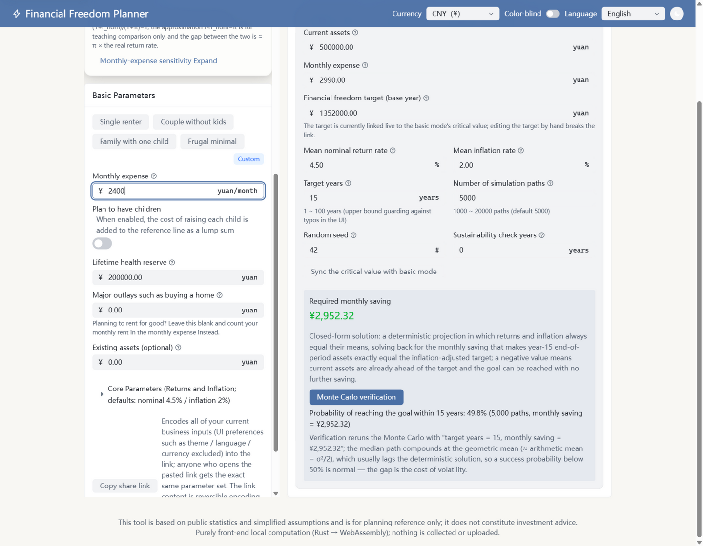 |
| *Panel ⑧ with two scenarios saved ("Base case" / "Lean version"): eight key metrics compared side by side — freedom reference line ¥1,635,200 vs ¥1,352,000, pension coverage ratio 95% vs 118%, while the other metrics (rental net annual cash flow −¥34,710.24, estimated monthly pension ¥2,842.03, sustainable monthly spending ¥2,541.67, monthly saving ¥5,010.00) coincide between these two scenarios; the table is recomputed per scenario by the deterministic core, and scenarios are stored in the browser-local library under the share-link encoding (limit 12), each with Load / Delete* | *Panel ⑥ with the simulation mode switched to "Back-solve savings": current assets ¥500,000, target ¥1,352,000 (linked live to the basic mode's critical value), target years 15 → the closed-form solution back-solves a required monthly saving of ¥2,952.32 (the note states returns and inflation are held at their means; a negative value means the goal is already ahead of the assets); clicking "Monte Carlo verification" reports a 49.8% probability of reaching the goal within 15 years (5,000 paths), noting that the median path compounds at the geometric mean and usually lags the deterministic solution — below 50% is normal, the gap being the cost of volatility* |

| Formula rationale and data sources (panel ⑨) | Reverse estimation · worked examples (panel ①) |
| --- | --- |
| 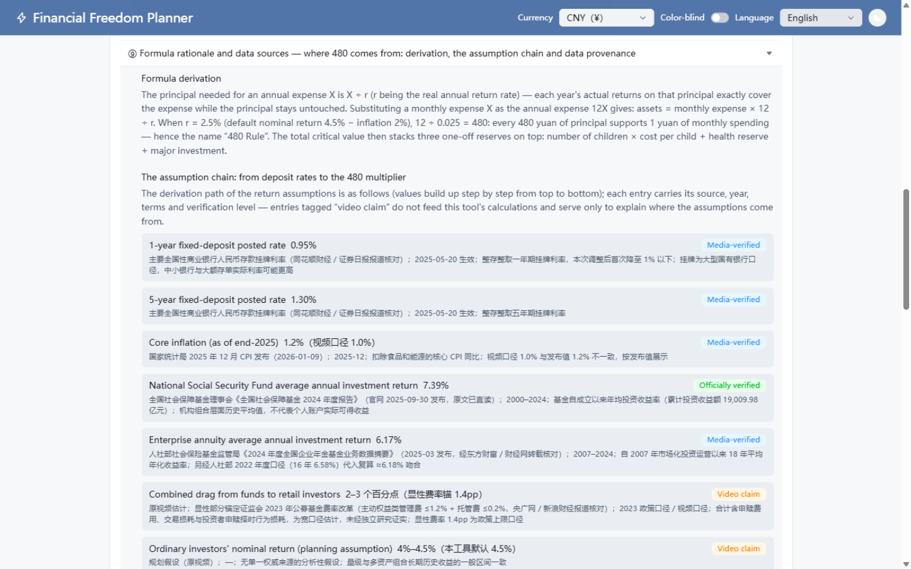 | 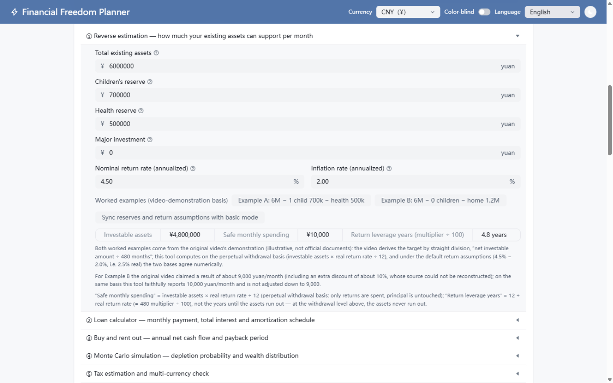 |
| *Panel ⑨ expanded: the formula derivation (assets = monthly expense × 12 ÷ r; at r = 2.5%, 12 ÷ 0.025 = 480) plus "The assumption chain: from deposit rates to the 480 multiplier" — 1-year fixed-deposit posted rate 0.95% → 5-year 1.30% → core inflation 1.2% → social-security fund average 7.39% → enterprise annuity average 6.17% → combined fee drag → nominal / inflation assumptions → real return → multiplier 480, each row with "source; year; terms" and a three-level verification tag (officially verified / media-verified / video claim); "video claim" entries never enter the computation; below follow conversion anchors, average-consumption references, regional child-raising costs, health-cost references and strict-vs-loose interpretation notes (the per-row source / year / terms strings stay in Chinese by data-layer convention)* | *Panel ①'s "Worked examples (video-demonstration basis)" buttons: clicking "Example A: 6M − 1 child 700k − health 500k" fills the inputs in one click (total assets ¥6,000,000 / children's reserve ¥700,000 / health reserve ¥500,000, return assumptions synced to 4.5% − 2.0%) → investable assets ¥4,800,000, safe monthly spending ¥10,000, return-leverage years 4.8; the note lines state that the examples come from the original video's demonstration (illustrative, not official documents), and that for Example B the video claimed about 9,000/month (including an extra ~10% discount that could not be reconstructed) while this tool reports 10,000/month on the same basis, not adjusted to 9,000* |

| Monthly-expense sensitivity · How appetite moves freedom | Scenario share · One link carries every input |
| --- | --- |
| 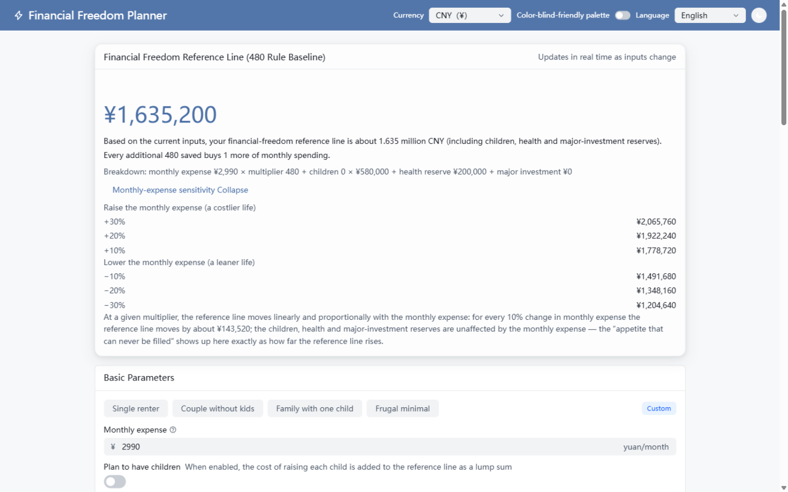 | 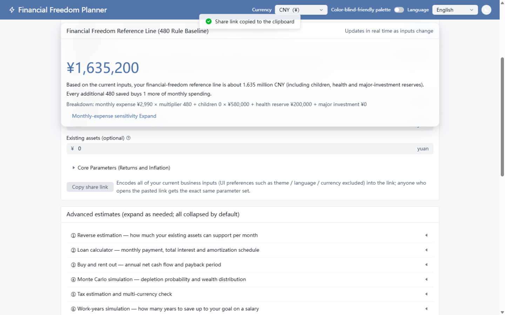 |
| *Clicking "Expand" on the output card refreshes the reference line for three raise and three lower steps (defaults: +10% ¥1,778,720, −10% ¥1,491,680), with the note that every 10% change in monthly expense moves the line by about ¥143,520; editing the expense refreshes all six rows with debounce* | *Clicking "Copy share link" shows the "Share link copied to the clipboard" notice: all business inputs (UI preferences such as theme / language / currency excluded) are encoded into the URL hash — anyone opening the pasted link gets the same parameter set; corrupt or unknown versions fall back to defaults with a notice* |

| Preset profiles · Fill a lifestyle in one click (the freedom-gauge ring is shown too) | Work-years simulation · How long until your savings reach the goal (panel ⑥) |
| --- | --- |
| 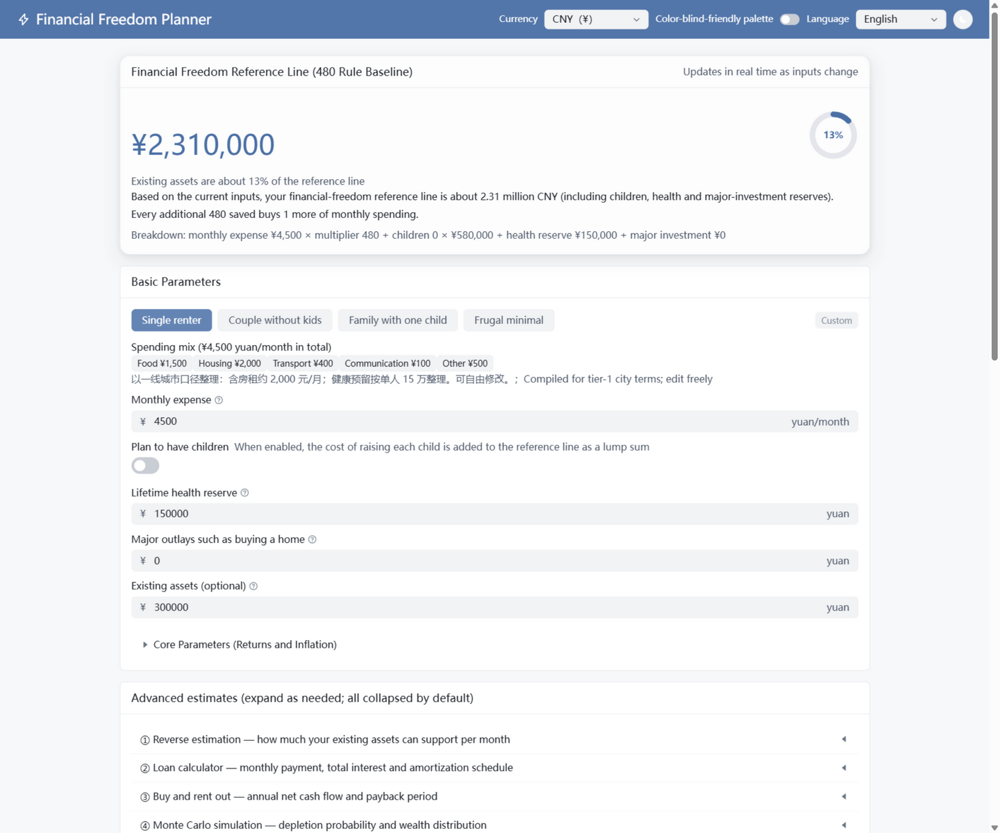 | 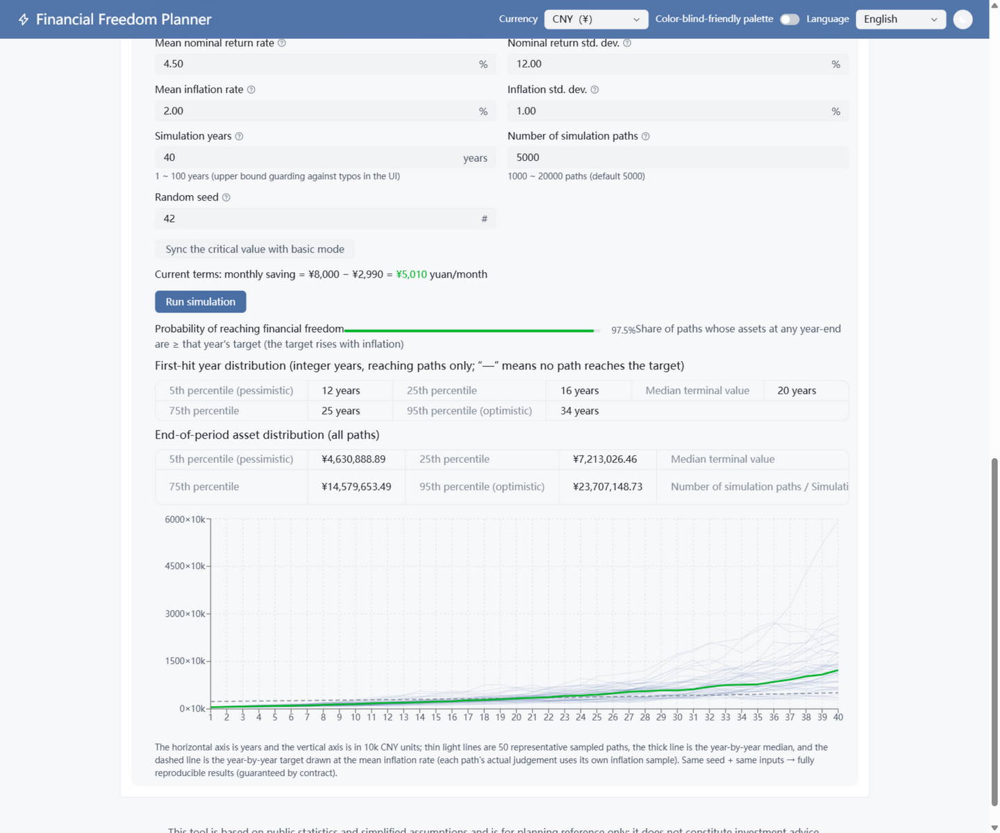 |
| *Clicking the "Single renter" profile fills monthly expense ¥4,500 and the ¥150,000 health reserve in one click, and the reference line updates to ¥2,310,000; read-only tags below show the spending mix (¥4,500 yuan/month in total: Food ¥1,500 / Housing ¥2,000 / Transport ¥400 / Communication ¥100 / Other ¥500); after entering ¥300,000 under "Existing assets (optional)", a progress ring appears beside the big number, labelled "Existing assets are about 13% of the reference line"* | *Panel ⑥ defaults (current assets ¥500,000, after-tax monthly income ¥8,000, monthly expense ¥2,990, monthly saving ¥5,010) with the target linked live to the basic critical value at ¥2,310,000: 5,000 paths × 40 years (seed 42) yield a 97.5% probability of reaching the goal, first-hit-year percentiles (5th/25th/50th/75th/95th = 12/16/20/25/34 years) and the terminal asset distribution (median ¥10,152,499.87); the chart draws 50 sampled paths + a median line + a dashed target rising with mean inflation — same seed + same inputs are fully reproducible* |

| Dark theme, first screen | First screen (red-box annotated) |
| --- | --- |
| 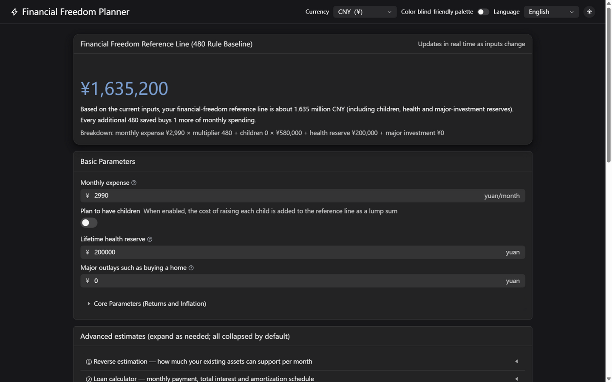 | 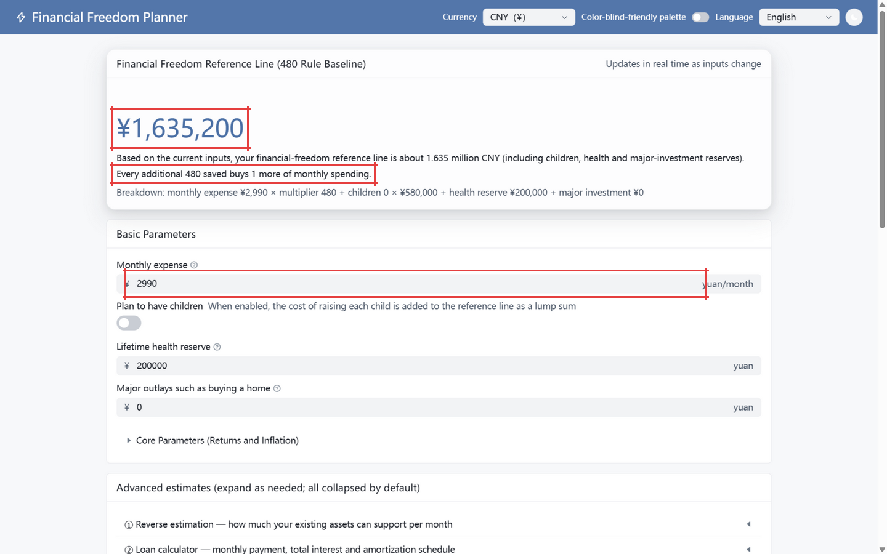 |
| *The same default inputs (¥1,635,200 ≈ 1.635 million CNY): page background, three-layer surface materials, text tiers and semantic colors all switch to the dark token group; one click on the topbar button — see "Design System"* | *Red boxes: the monthly-expense input → the large-font critical value (defaults: ¥1,635,200 ≈ 1.635 million CNY) → the coupled line "Every additional 480 saved buys 1 more of monthly spending."* |

| Monte Carlo result (red-box annotated) |
| --- |
| 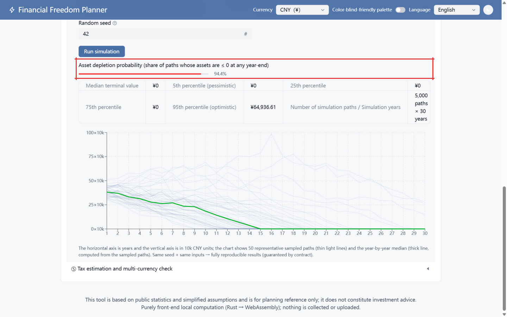 |
| *Red box: asset depletion probability 94.4% — a conservative case of 500,000 assets and ~36,000/year spending (≈ 7.2% withdrawal rate); below it, the percentile terminal values and the chart of 50 sampled paths + the median curve (default inputs: 4.5% ± 12%, inflation 2% ± 1%, 30 years, 5,000 paths, seed 42)* |

| ① Reverse estimation | ② Loan calculator |
| --- | --- |
| 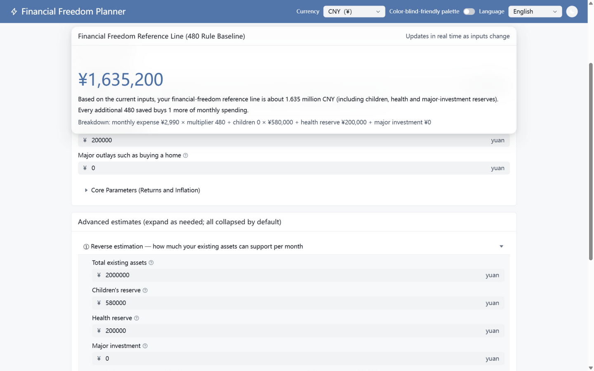 | 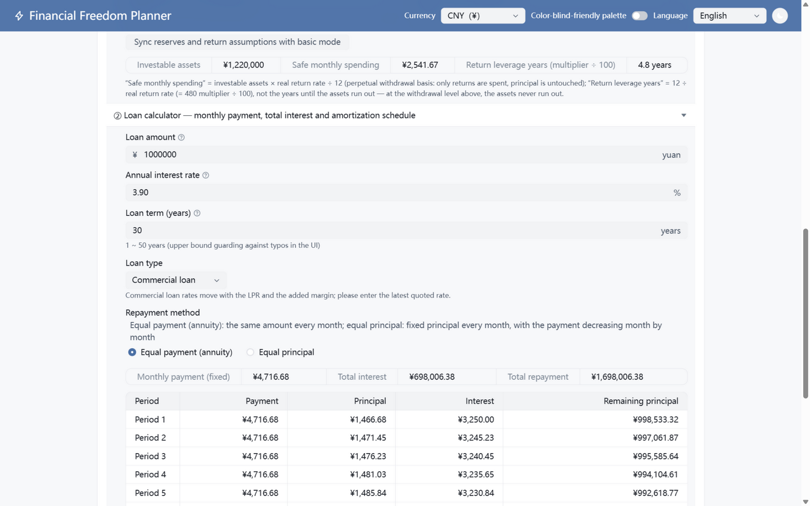 |
| *Panel defaults (total assets 2,000,000, children's reserve 580,000, health reserve 200,000) → investable assets ¥1,220,000 → safe monthly spending ¥2,541.67 — warning: the perpetual basis holds within the model’s assumptions (returns always positive, spending rising with the model); real-world sequence risk can break it. Cf. Morningstar 2026: a 30-year horizon with a 90% success rate and 30%–50% equity portfolios gives a 3.9% starting safe withdrawal rate (fixed-real-spending baseline, excluding pensions and other external income; yearly figures have drifted between 3.3% and 4.0% with market assumptions), based on U.S. market assumptions and not a guarantee in any environment (perpetual-withdrawal basis, noted in the panel; return-leverage years 4.8)* | *1,000,000 / 3.9% / 30 years, equal payment (annuity): monthly payment ¥4,716.68, total interest ¥698,006.38, total repayment ¥1,698,006.38, with a per-period amortization schedule; loan type is selectable and rates are meant to be entered from the latest market quotes* |

| ③ Buy and rent out (panel defaults) | ⑤ Tax estimation (China) |
| --- | --- |
| 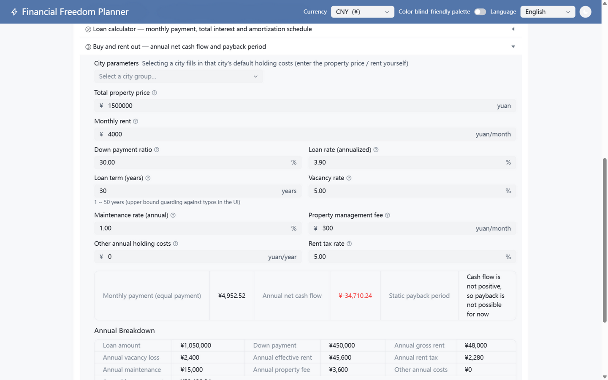 | 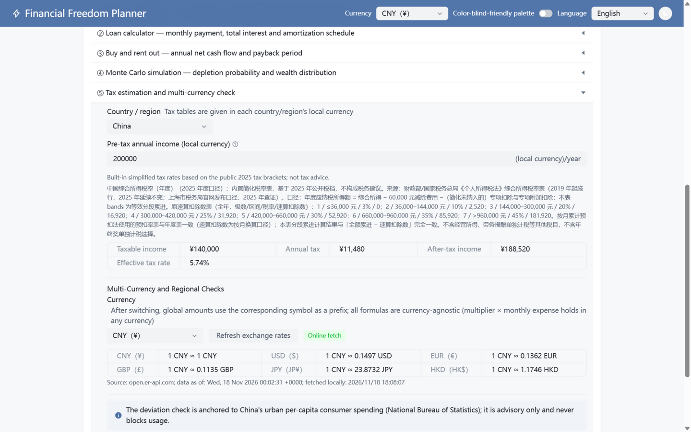 |
| *Defaults (price 1,500,000, rent 4,000/month, 30% down, 3.9% rate, 30 years, 5% vacancy, etc.): monthly payment ¥4,952.52; annual net cash flow −¥34,710.24 is shown honestly in red, and payback reads "Cash flow is not positive, so payback is not possible for now"* | *China table, 200,000/year: taxable income ¥140,000 → annual tax ¥11,480, after-tax income ¥188,520, effective rate 5.74%; the full source, conventions and quick-deduction table are shown in the panel* |

| Multi-currency (USD) | Mobile, 375 px |
| --- | --- |
| 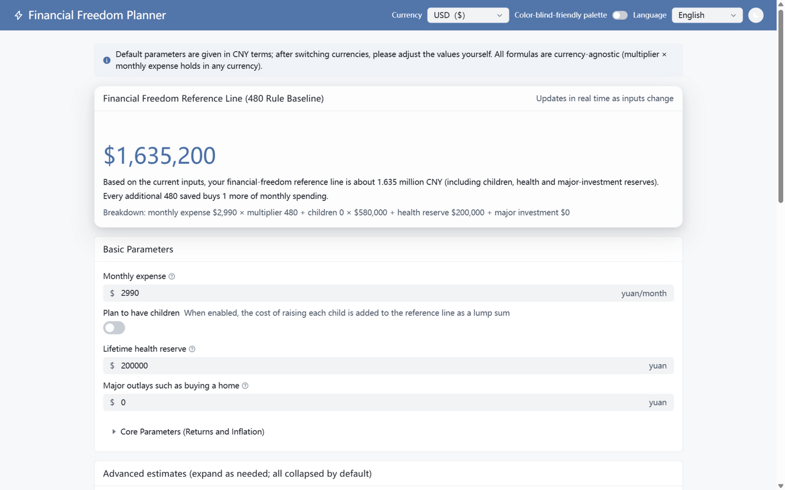 | 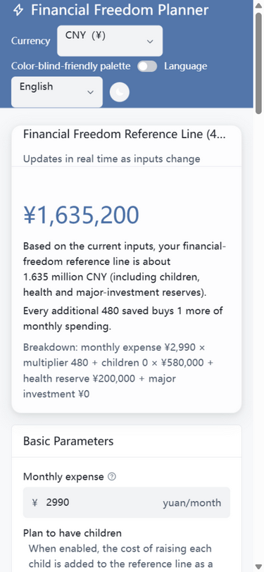 |
| *Switching the currency in the topbar (CNY → USD) updates every amount symbol app-wide, with a non-blocking notice that "Default parameters are given in CNY terms" — all formulas are currency-agnostic* | *Single-column layout, topbar tools wrapping automatically, amounts never break mid-figure, no horizontal overflow* |

| ③ Buy and rent out · City group direct select (sample cities in small right-hand text) | After selecting "Intl · Global financial hubs" (group range + representative city + grading conventions) |
| --- | --- |
| 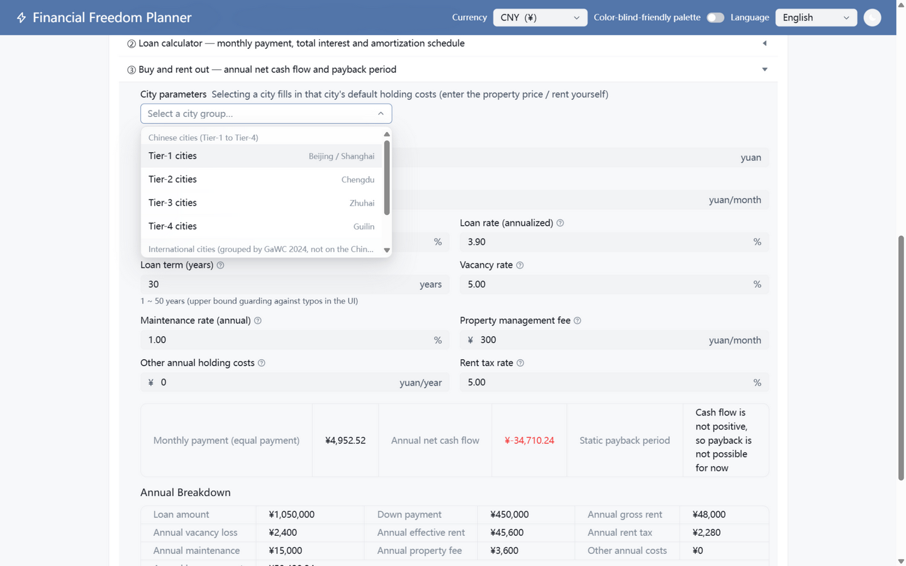 | 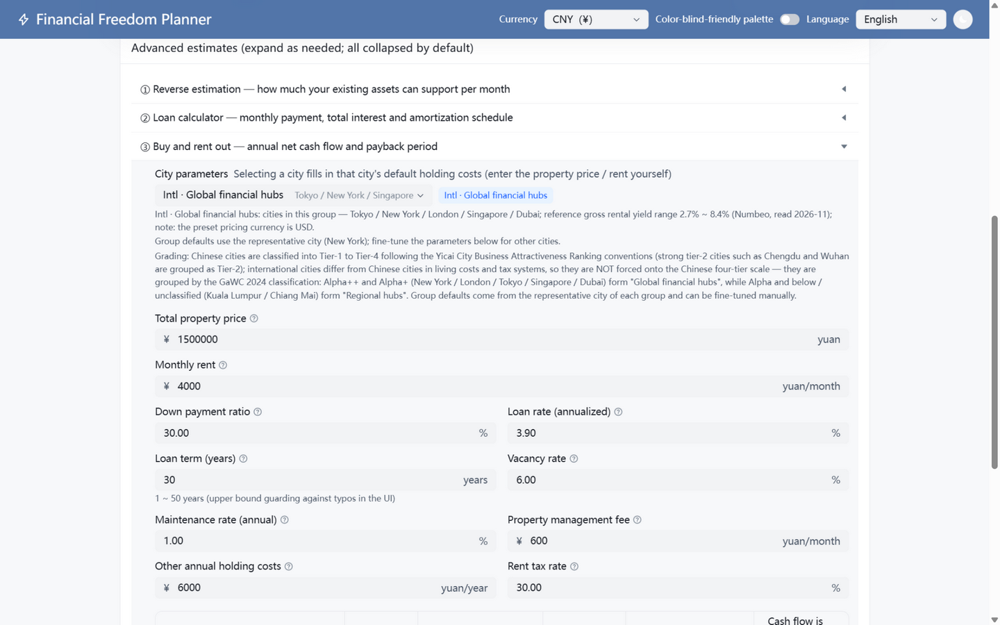 |
| *Two groups: Chinese cities in four tiers (Tier-1 to Tier-4, sample cities in small text, e.g. Tier-1: Beijing / Shanghai); international cities are NOT forced onto the Chinese four-tier scale — they follow the GaWC 2024 classification (noted at the bottom of the dropdown)* | *Selecting a group shows: member cities (Tokyo / New York / London / Singapore / Dubai) with the reference gross rental yield range (2.7% – 8.4%, Numbeo, read 2026-11), a preset-currency notice, representative-city (New York) defaults and the grading conventions* |

| PWA install · manifest verification (DevTools, English UI) |
| --- |
| 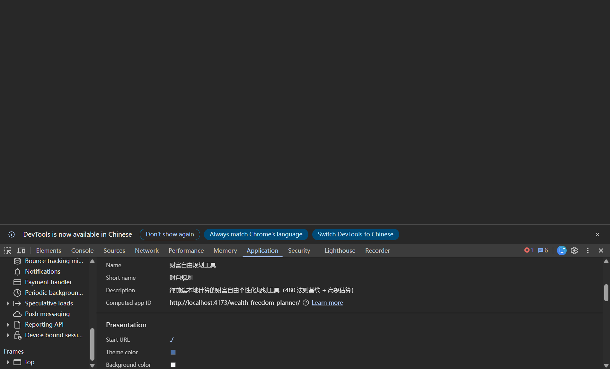 |
| *DevTools "Application → Manifest" panel verifying the build output: Name 财富自由规划工具, Short name 财自规划, Start URL `./`, Display standalone; the manifest is single-language by design (lang zh-CN per docs/p4-spec.md §6.2), so its strings stay in Chinese while all in-app text follows the interface language; the handwritten service worker (`src/sw.ts`) pre-caches every local asset (WASM core included), so the app installed to the desktop / home screen runs offline; updates swap in silently (autoUpdate) with no prompt* |

> [!NOTE]
> The full screen-by-screen set — including the mobile Monte Carlo chart (`demo-mobile-montecarlo.png`) and the interface-language captures (`demo-lang-*.png`, Chinese UI) — lives in `docs/assets/`; this folder (`docs/assets/en/`) mirrors the application in English.

## ✨ Features

The interface follows a written design language — “Quiet Ledger” (静水账房, [docs/design-language.md](docs/design-language.md)): numerals set in tabular figures, hierarchy carried by hairline rules, the progress ring doubling as a gauge scale, and exactly one celebratory motion — a single pulse when the 100% mark is reached. This round's interaction upgrade keeps the same voice: output-card value changes carry a one-time tint fade to show what changed, the six panel headline numbers converge asymptotically, all five charts gain hover read-outs, and theme switching transitions as a circular reveal — every motion still degrades instantly under the system's reduced-motion preference.

| Feature | Status | Notes |
| --- | :-: | --- |
| 480 Rule baseline | ✅ Done | Multiplier and critical value update live; a real return rate ≤ 0 raises an explicit error instead of silently returning a number |
| Formula rationale and data sources | ✅ Done | Panel ⑨: the formula derivation (assets = monthly expense × 12 ÷ r; at r = 2.5%, 12 ÷ 0.025 = 480), the assumption-chain table (deposit posted rates → core inflation → social-security fund average 7.39% → enterprise annuity average 6.17% → combined fee drag → nominal / inflation assumptions → real return → multiplier 480, each row with source / year / terms and a three-level "officially verified / media-verified / video claim" tag), conversion anchors, average-consumption references (2025 national ¥2,456 / urban ¥2,989 per month), regional child-raising costs (original figures from the 2024 child-raising cost report) and health-cost references, plus strict-vs-loose interpretation notes; "video claim" entries are labeled as such and never enter the computation |
| Reverse estimation | ✅ Done | Existing assets minus reserves → the monthly amount you can safely spend (perpetual-withdrawal basis + return-leverage years, noted in the panel) |
| Loan calculator | ✅ Done | Loan type selectable (rates to be entered from the latest market quotes); equal payment (annuity) / equal principal, per-period amortization schedule + total interest and total repayment |
| Buy and rent out | ✅ Done | Annual net cash flow + payback period; city parameters offer two direct-select groups: Chinese cities in **Tier-1 to Tier-4**, international cities grouped by **GaWC 2024** (not on the Chinese scale); selecting a group applies the representative city's parameters and shows member cities, the reference yield range and the grading conventions (data with source annotations) |
| Interface language | ✅ Done | **简体中文 / 繁體中文 / English** switching (preference persisted; first visit follows the browser language; component-library locale follows along) |
| Light / dark themes | ✅ Done | First visit follows the system preference; the topbar button toggles manually and persists (an explicit choice takes precedence over the system); page background, three-layer materials, charts and semantic colors all reskin; instant switching under the system "reduced motion" preference |
| Monte Carlo simulation | ✅ Done | 5,000 paths by default; fixed random seed, fully reproducible; depletion probability, median and 5/25/75/95 percentile terminal values + a 50-path sample chart |
| Preset profiles | ✅ Done | Four lifestyle presets (single renter / couple without kids / family with one child / frugal minimal) fill all base inputs in one click and show the spending mix as read-only tags; editing any input switches back to "Custom" |
| Freedom gauge | ✅ Done | With the optional "Existing assets" field filled in, an SVG progress ring (assets ÷ critical value, percentage centered) appears beside the big number, labelled "Existing assets are about X% of the reference line" |
| Work-years simulation | ✅ Done | Given after-tax monthly income and expense, simulates saving paths under nominal-return and inflation randomness: probability of reaching the goal, first-hit-year percentiles (P5–P95), terminal asset distribution and a 50-path chart; the target rises with inflation and same-seed runs are reproducible |
| Public pension estimate | ⚠️ Simplified | Simplified two-layer formula (basic pension + individual account) estimates the monthly pension at retirement from current/retirement age, contribution years and base index, an individual-account-balance estimate and the benefit-computation average wage; outputs an "adjusted reference line" — the expense share already covered by the pension no longer needs principal support; no year-by-year growth is assumed for the average wage or the base index, and no future appreciation for the account balance; the panel carries a fixed "simplified estimate, not social-security advice" notice |
| Historical bootstrap (Monte Carlo return mode) | ✅ Done | Return mode selectable: normal parameters (classic) or i.i.d. resampling with replacement from the real annual return series of CSI 300 / S&P 500 (keeps the real fat tails and skewness, ignores year order); statistics and chart conventions identical to the normal mode, same-seed runs reproducible |
| Dynamic withdrawal strategies (Monte Carlo) | ✅ Done | Three withdrawal rules selectable: fixed real spending (inflation-adjusted, default) / threshold band (±10% correction when the current rate drifts ±20% from the initial rate, no cuts in the final 15 years, inflation uplift frozen after a negative-return year — all tunable) / percentage-of-balance (annuitized to the horizon at a real-return assumption, optional floor & cap, depletion-proof by construction); terminal-year withdrawal percentiles quantify purchasing-power risk; same-seed reproducible |
| Sequence-of-returns comparison | ✅ Done | Deterministic simulation (no randomness) over the real CSI 300 / S&P 500 annual series: rolling start (each start backtested; best / median / worst terminal-value fate curves + window-count note) and reorder comparison (same series in original / ascending / descending order — geometric mean unchanged, terminal differences purely from order); inflation set to 0 (nominal = real); limited windows honestly labelled as illustrative |
| Scenario comparator | ✅ Done | Save all business inputs under a name (reusing the share-link encoding with version checks) into a local scenario library (up to 12), and compare key metrics side by side — freedom reference line, rental cash flow, pension, after-tax income, monthly saving (deterministic core re-runs per scenario, milliseconds) |
| Target-date reverse saving (work-years panel) | ✅ Done | Given a horizon, the closed-form solution (returns & inflation held at their means) back-solves the required monthly saving (negative = already ahead); one-click Monte Carlo verification gives the probability of reaching the goal within the horizon, noting volatility drag (median paths compound at the geometric mean) |
| Tornado & waterfall charts | ✅ Done | Expense sensitivity upgraded to a tornado chart (sorted by deviation + baseline reference line + direction colors, numeric rows kept beneath as the data-table alternative); rental annual breakdown gains a waterfall chart (gross rent → deductions → net cash flow bridge, three-role palette + dashed connectors, falls back to the detail table on narrow screens); all charts get dual-theme parameters and aria summaries; not-running states use the standard empty component |
| Expense sensitivity (appetite) | ✅ Done | The base output card's "Monthly-expense sensitivity" section expands to show the reference line at ±10% / ±20% / ±30% monthly expense (re-running the baseline per step, computed only while expanded), quantifying how appetite lifts the line |
| Scenario share link | ✅ Done | "Copy share link" encodes all business inputs (base / reverse / loan / rental / Monte Carlo / work-years / tax / progress ring / pension) into the URL hash (versioned + base64url); opening the link restores them, corrupt or unknown versions fall back to defaults with a notice |
| Tax estimation | ⚠️ Simplified | Simplified 2025 brackets for 8 countries/regions (China / US federal / UK / Germany / Japan / Singapore / Australia / Canada); social contributions, itemized special deductions, local taxes etc. are **not** included |
| Multi-currency | ⚠️ Simplified | Online, live rates come from the free open.er-api.com endpoint (no key, timestamp shown); the **offline snapshot carries real values** (open.er-api.com, data as of 2026-11-20, checked 2026-11-21) (see known limitations) |
| Responsive design | ✅ Done | Breakpoint matrix **375 / 640 / 768 / 1024 / 1440** (768 is the only hard breakpoint; the topbar's compact tier is field-measured up to 789.9): three-tier topbar packing (narrow tiers hide text labels visually while keeping screen-reader semantics and aria-labels; selects narrow and show short-form current values), a bottom action dock (the share link stays pinned in the natural thumb zone on narrow screens, and the Monte Carlo "Run simulation" gets a sticky in-panel placement), narrow-screen tables with sticky first column + right-edge fade + swipe hint, a compact output card (breakdown summary + expand, 56 px gauge ring), three chart heights (240 / 280 / 320) with compact-tier tick thinning; touch-target rules: interactive controls at least 44 px (preset buttons, collapse headers, extended hit areas for mini action buttons), with a second confirmation before destructive actions such as scenario deletion |
| Color-blind-friendly palette | ✅ Done | A high-separation blue/orange pair replaces the green/red semantic colors (with per-theme adapted values) |
| PWA offline install | ✅ Done | The build ships a web app manifest and a handwritten service worker (`src/sw.ts`): all local assets are pre-cached (WASM core included), the app installs to the desktop / home screen and works offline; updates swap in silently (autoUpdate) — no update prompt, no interruption |
| Accessibility | ✅ Done | Keyboard-reachable: a "skip to main content" link, collapse-header focus rings, focusable field-tip icons that open their tooltip on focus; screen readers: banner / main / contentinfo landmarks, programmatic field–label association (aria-labelledby / describedby), polite announcements of settled results, charts with aria summaries and visible data tables; contrast audited at the AA threshold (body text ≥ 4.5:1) by a token-level script (`npm run check:a11y`), with the few light-theme semantic exemptions registered in the spec |
| Scenario export PNG | ✅ Done | The multi-scenario comparison exports its key-metric table as a PNG in one click (hand-drawn on a native Canvas, zero new dependencies); colors come from the currently active theme tokens (color-blind-friendly mode included) and labels follow the interface language; the button is disabled while no valid scenario exists |
| Accounts / cloud sync / live market data | ❌ Not built | Purely local static app — deliberately no backend; no market-data feeds |

> Input constraints: amounts 0 – 1,000,000,000 (integers, step 100), percentages 0.01% – 30%, path counts 1,000 – 20,000; invalid inputs raise explicit errors instead of being silently corrected. The newer withdrawal-strategy / sequence-risk / back-solve fields are validated against their own panel-annotated ranges and likewise raise explicit errors.

## 🧰 Tech Stack

| Layer | Choice |
| --- | --- |
| Framework | React 18 + Vite 6 + TypeScript (`strict`) |
| UI components | `@arco-design/web-react` (component library, including its built-in icons) |
| State | zustand |
| Charts | recharts (only in the advanced Monte Carlo panel) |
| i18n | i18next + react-i18next (three locale files with identical key sets) |
| Compute core | Rust → WASM (wasm-pack `--target web`, JSON in / JSON out): money math via `rust_decimal` (`arbitrary_precision` exact parsing, no f64 round-trips), amortization reference `rust_finprim`, sampling `rand` + `rand_distr` |

## 🚀 Quick Start

Prerequisites: Node.js ≥ 18 (with npm), the Rust toolchain with the `wasm32-unknown-unknown` target, and `wasm-pack` (`cargo install wasm-pack --locked`, or install from [rustwasm.github.io](https://rustwasm.github.io/wasm-pack/installer/)).

```bash
npm install
# Build the compute core (output goes to src/wasm/pkg/, which is committed —
# you can skip this step and run directly)
wasm-pack build src/wasm --target web --out-dir pkg --release
npm run dev       # dev server
```

Build and checks:

```bash
npm run build        # tsc --noEmit && vite build (type check + production build into dist/)
npm run preview      # preview the production build
npm run check:size   # size gate: dist total ≤ 2MB and largest .wasm ≤ 800KB; exits 1 on violation
cargo test --manifest-path src/wasm/Cargo.toml   # unit/integration tests of the compute core
```

> [!NOTE]
> The tests include two key regression locks: Monte Carlo output is **byte-identical for the same input + seed** (determinism), and the nominal-recursion closed form is checked against **known values**.

## 🎨 Design System

The UI follows a build-ready design specification — full token values, component rules, the motion inventory, accessibility measurements and an itemized acceptance checklist live in [docs/design-spec.md](docs/design-spec.md). The specification's parameters are calibrated through a systematic cross-audit against mainstream industry design guidelines (process and recomputed values in [docs/design-research.md](docs/design-research.md)). Highlights:

- **Design tokens**: all styling is organized through `--wf-` CSS variables and `wf-` class prefixes, split into a theme-independent static layer (8-pt spacing, radii, type scale, motion durations and curves) and a dynamic layer that switches with the theme (page background, text tiers, materials, hairlines, shadows, focus rings, semantic colors, chart colors). The single source of truth lives in `src/data/defaults.ts` (light group `THEME` / dark group `THEME_DARK`, same keys, two value sets) and is injected into the document root at runtime; stylesheet defaults match the injected values key-for-key, and a first-frame guard script in `index.html` prevents theme flash.
- **Three-layer surface materials**: the topbar, the floating output card and overlays are each built from four elements — translucent background → backdrop blur + saturation → 1 px hairline → shadow tokens. Blur radius carries the layer semantics (identical values in both themes); plain content cards stay solid and do not participate in materials. Dark-mode material opacities are pinned by a worst-case underlying-content contrast rule — they are not free parameters.
- **Motion & touch**: motion exists only to make state changes perceptible — three duration steps (120 / 240 / 360 ms) and three curve families (standard / emphasis / asymptotic), all via tokens, with no bare literals inside components; entrance animations play once and at most two motions run simultaneously; press feedback (scale + opacity), `:focus-visible` rings with per-surface variants, and a 44 px minimum touch target.
- **Light / dark themes**: the first visit follows the system preference (`prefers-color-scheme`); the topbar button toggles manually and persists to localStorage — once chosen explicitly, the stored value takes precedence over the system; the `data-theme` attribute is always present and queryable, and the browser theme-color meta updates in sync. Dark adaptation of component-library surfaces (cards, popups) rides on the library's own theme mechanism, while the brand primary scale stays constant in both themes.
- **Accessibility & automatic degradation**: with the system "reduced motion" preference enabled, CSS transitions stop, numbers snap to their values, charts render without animation, and theme switching is instantaneous (CSS + JS channels). Text contrast is measured under both the resting composite background and the worst-case underlying-content calibers (every dark-mode token ≥ 4.5:1; existing light-mode semantic-color exemptions are registered honestly in the spec rather than passed off as compliant).

## 📦 Deploy to GitHub Pages

```bash
bash scripts/deploy.sh
```

The script runs, in order: `npm run build` → `cd dist && touch .nojekyll` → `git add -A && git commit` → `git push origin HEAD:gh-pages --force`. Implementation detail: `dist/` hosts an inner standalone git repository carrying the deployment snapshot (tree root = `index.html` + `.nojekyll`), so Pages' `/ (root)` setting works directly.

One-time GitHub Pages settings (repo Settings → Pages):

- **Source**: Deploy from a branch
- **Branch**: `gh-pages`
- **Folder**: `/ (root)`

> [!IMPORTANT]
> Before the first deploy, add a remote: `git remote add origin <your-repo-url>`. This repository **deliberately creates no `.github/workflows`** — deployment is done locally, entirely by the script.

## 📊 Data Sources & Conventions

| Data | Source | Year / verified | Conventions |
| --- | --- | --- | --- |
| China individual income tax | Individual Income Tax Law comprehensive rate table, Ministry of Finance / State Taxation Administration (as published by the Shanghai tax bureau) | extended into 2025, verified 2026-11 | 60,000 yuan/year standard deduction; the quick-deduction table is converted to an equivalent bracket progression; **excludes** special and itemized special deductions |
| US federal + 6 other tax regimes | IRS Rev. Proc. 2024-40, GOV.UK, Germany §32a EStG, Japan NTA, IRAS, ATO, CRA | 2025 | Each table's `note` field records the local-currency basis and exclusions |
| City rental yields | Numbeo city property pages (rolling 18-month window) | read 2026-11, base year 2025 | Gross yield (annual rent ÷ price); holding costs are market-convention estimates (see each city's `note`) |
| City grouping | China: organized from Yicai's City Business Attractiveness Rankings and common conventions (Tier-1 to Tier-4); international: GaWC (Globalization and World Cities Research Network) 2024 classification (not on the Chinese scale) | classified 2024, verified 2026-11 | Alpha++ and Alpha+ → global financial hubs; Alpha and below / unclassified → regional hubs; international cities use independent living-cost and tax conventions and are not compared head-to-head with Chinese cities |
| GDP per capita (PPP) / consumption share | World Bank API (NY.GDP.PCAP.PP.CD / NE.CON.PRVT.ZS) | 2024 values, snapshot 2026-11-11 | National basis, for scale reference only |
| Household consumption / Engel coefficient (China) | National Bureau of Statistics, "2024 household income and consumption expenditure" | published 2025-01-17 | Urban per-capita consumption 34,557 yuan/year ≈ 2,880 yuan/month (the reference behind the default 2,990 monthly expense) |
| Exchange rates | open.er-api.com free open endpoint (no key) | fetched live, timestamp shown on page | 8-second timeout; on failure/timeout falls back to the bundled snapshot labeled "offline snapshot" |

> Every dataset in `src/data/**` carries structured `source` / `year` / `note` fields that are shown on screen; code comments are the authoritative statement of each convention.

## ⚠️ Known Limitations & Implementation Notes

What this project **cannot do today, or simplifies on purpose** — please read before using:

> [!WARNING]
> **The Monte Carlo model assumes returns and inflation are normally distributed** — real markets have fat tails and volatility clustering, so extreme years are under-covered. The recursion is nominal-basis (assets × (1 + nominal return sample) − inflation-indexed spending; contract in `src/wasm/bridge.ts`, locked by closed-form regression tests); sampling uses f64 per statistical convention, while money inputs/outputs remain exact-parse.

> [!WARNING]
> **Tax tables are heavily simplified**: no social contributions/housing funds, no itemized special deductions, no local taxes or foreign national-insurance schemes — effective rates can deviate substantially from reality. The China table replaces quick-deduction amounts with an equivalent bracket progression (mathematically identical).

> [!WARNING]
> The offline exchange-rate snapshot **carries real values** (USD 0.149433 / EUR 0.136198 / GBP 0.113982 / JPY 23.877343 / HKD 1.172212 / CNY 1; open.er-api.com, data as of 2026-11-20): the multi-currency panel converts offline as usual; online it works (free endpoint, no key). A full snapshot is on the roadmap.

> [!NOTE]
> Rental yields and holding costs are **range and convention estimates**, not quotes; Engel coefficients differ widely across official definitions (China uses the eight-category food/tobacco/alcohol basis) and are annotated in the data layer — **do not compare them head-to-head**.

> [!NOTE]
> The "years sustainable" figure in reverse estimation is a **return-leverage convention** at a fixed real return rate (same origin as the 480 multiplier) — it does **not** mean "this money only lasts N years"; the panel copy explains further.

> [!NOTE]
> All defaults (monthly expense 2,990, 580k per child, 200k health reserve, 4.5% nominal, 2.0% inflation) are **reference conventions organized from public statistics**, not advice for any personal situation; adjust them to your own.

## 🗺 Roadmap

- [ ] Fill in a complete offline exchange-rate snapshot (with timestamp and source annotation)
- [ ] More tax jurisdictions and city parameters, with an annual review mechanism
- [ ] Result export (scenario save/compare is already covered by the scenario comparator)
- [ ] Optional historical-series calibration (a complementary view beyond the pure normal assumption)

## 🧱 Project Structure

```
├── index.html                 # lang="zh-CN", title「财富自由规划工具」; first-frame theme guard (prevents flash)
├── scripts
│   ├── check-size.mjs         # size gate (dist total / largest .wasm; limits overridable via env vars)
│   └── deploy.sh              # GitHub Pages deploy (gh-pages branch)
├── src
│   ├── App.tsx                # page shell (topbar / calculators / disclaimer) + theme token injection & switching
│   ├── main.tsx               # entry: async bootstrap of WASM init
│   ├── components
│   │   ├── BasicCalculator.tsx    # basic mode (480 Rule baseline, default first screen)
│   │   ├── AdvancedPanel.tsx      # advanced estimates (9 sub-panels in a Collapse)
│   │   ├── advanced/…             # reverse / loan / rent-out / monte carlo / tax+multi-currency / work-years / pension / scenarios / formula rationale
│   │   └── fields.tsx / hooks.ts  # form fields; useFinanceCall & motion hooks
│   ├── i18n                   # react-i18next init + three locale files (zh-CN / zh-Hant / en)
│   ├── services
│   │   ├── finance.ts         # WASM call adapter (never throws; failures become structured errors)
│   │   ├── format.ts          # number/currency formatting
│   │   └── rates.ts           # rate fetching (URL safety check + offline snapshot fallback)
│   ├── store/useCalculatorStore.ts
│   ├── data                   # types / defaults (incl. both theme token groups) / taxTables / rentParams / regional
│   ├── styles/global.css      # token / material / dark-override / motion sections
│   └── wasm
│       ├── bridge.ts          # WASM interface contract (TS types, single source of truth)
│       ├── Cargo.toml         # finance-core crate definition
│       ├── src/               # lib.rs and compute modules (baseline/amort/rental/reverse/montecarlo/bootstrap/pension/tax/common/accumulation/withdrawal/sequence)
│       ├── tests/             # cargo integration tests
│       └── pkg/               # wasm-pack output (glue JS / d.ts / wasm, committed)
└── vite.config.ts             # base:"./" for GitHub Pages relative paths
```

## 🙏 Acknowledgements

- **Inspiration video: [《你需要多少钱，才能财富自由？》 ("How much money do you need to be financially free?")](https://www.bilibili.com/video/BV1yUHP6rEYD/) (released 2026-10-24)** — the origin of this project's "480 Rule" baseline. All views and content of the video belong to its original publisher; this project is a learning implementation of the idea and is not affiliated with the video's creator.
- Open-source components: [@arco-design/web-react](https://github.com/arco-design/arco-design), [rust_decimal](https://github.com/paupino/rust-decimal), [rust_finprim](https://github.com/daneski13/rust-finprim), [wasm-pack](https://github.com/rustwasm/wasm-pack), [Recharts](https://recharts.org), [zustand](https://github.com/pmndrs/zustand).
- Data: public statistics and institutional publications (see the data-sources table above).

## 📄 License & Terms of Use

This project is **for learning purposes only** and ships without an open-source license (all rights reserved). If you reuse the code or the organized data, keep this README's disclaimers and data-source annotations; the video content and third-party data remain the property of their respective rights holders, and any citation must follow the corresponding source's license and terms.

---

> [!WARNING]
> One more reminder: **this tool is based on public statistics and simplified assumptions; it is a planning reference only and does not constitute investment advice.** Numbers can mislead — always combine them with your own situation and professional advice.
