**简体中文** | [English](README.en.md)

<div align="center">

# 财富自由规划工具

**基于「480 法则」的本地财富自由规划器 · 纯前端 · Rust → WebAssembly · 不上传任何数据**

[](https://react.dev)
[](https://rustwasm.github.io/)
[](#-功能特性)

*灵感来源：视频《你需要多少钱，才能财富自由？》（2026-10） · [▶ 观看原视频](https://www.bilibili.com/video/BV1yUHP6rEYD/)*

</div>

> [!IMPORTANT]
> **本项目仅供学习交流与个人规划参考，不构成任何金融产品、投资顾问服务或持牌咨询。**
> 本项目是上述视频思路的**学习性代码实现**，用于练习 Rust/WASM、React 与前端工程化——不是理财产品，不提供任何投资建议，与原视频发布者无任何关联。

> [!WARNING]
> 工具的**所有输出都是简化数学模型的结果**，可能存在口径偏差或与最新政策不符之处。它**不构成投资、税务或法律建议**；任何现实决策请自行核实官方来源并咨询持牌专业人士。

> [!CAUTION]
> 内置数据（税率表、租金收益率、汇率等）为**撰写/查证时点的公开数据快照**（多为 2024–2025 年度口径，2026-11 查证），税政与市场数据随时可能变化。使用前请对照页面标注的来源与年份，勿将其视为最新权威数据。

> [!NOTE]
> 所有计算在浏览器本地（Rust → WebAssembly）完成，**不上传、不采集任何用户数据**；基础计算在无网络环境下同样可用（多币种换算的实时汇率除外，见「已知局限」）。

---

## 📖 项目是什么

核心是「480 法则」基线计算——一个在视频中流行的通俗简化模型（**非学术结论**）：

```
临界值 = (12 ÷ 实际回报率) × 月开销 + 育儿总成本 + 健康预留 + 重大投入
实际回报率 = 名义回报率 − 通胀率          （默认 4.5% − 2.0% = 2.5% → 乘数 480）
```

在默认参数（月开销 2,990 元，参考国家统计局城镇居民人均消费支出口径整理）下，财富自由参考线约为 **163.5 万元**。输入任何一项变化，结果即时联动。

高级估算与公式原理采用**「分段控件 + 组内标签页」导航**（九个子面板分为三组：人生规划 / 购房金融 / 分析工具；同屏单一焦点，跨组切换保留已运行的模拟结果与表单输入，方向键在组内标签间漫游），额外提供：反向估算、贷款测算、买房收租分析、蒙特卡洛模拟（收益模式可选正态参数或历史自助抽样，支取策略可选固定名义 / 阈值带调整 / 余额比例，面板内附确定性「序列风险对照」子区）、社保养老金估算、税务估算与多币种校验、打工模拟（支持按目标年限反推所需月储蓄）、多情景对比（浏览器本地场景库 + 关键指标并排对比）；基础输出卡可展开「月开销敏感性」小节（±10% / ±20% / ±30% 三档参考线），「复制分享链接」把全部业务输入编码进 URL，打开链接即恢复同一套参数。整个应用可作为 PWA 安装到桌面 / 主屏，安装后离线可用，计算仍全部在本地完成。

## 📸 效果演示

> 以下全部为**真实运行画面**：本仓库构建产物的实际截图，非设计稿或手绘。

<div align="center">

### 基础计算 · 输入实时联动


*在「每月开销」中连续输入（2,990 → 5,600 → 8,000）：临界值大字号、「万」换算行与构成明细即时重算；大字号以约 360ms 的渐近滚动过渡（GIF 录制在数字收敛落定前截止，按末帧明细 ¥8,000 × 480 + ¥200,000，落定值为 ¥4,040,000）*

### 蒙特卡洛模拟 · 一键运行 5,000 条路径

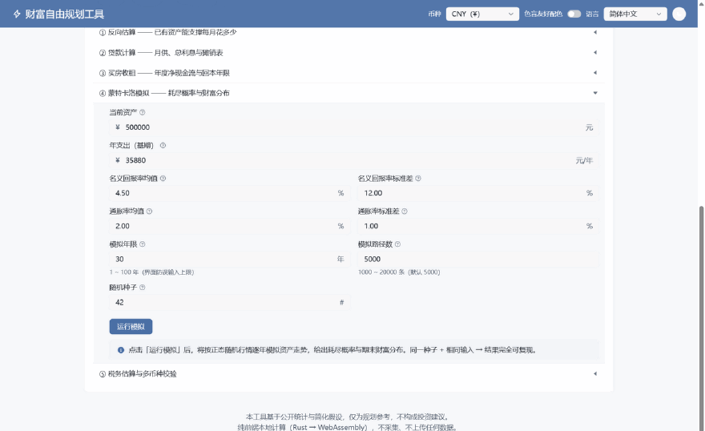

*点击「运行模拟」，计算核心在浏览器本地完成 5,000 路径 × 30 年模拟；将随机种子 42 改为 2024 重跑：耗尽概率 94.4% → 94.2%，第 95 百分位 ¥64,936.61 → ¥77,407.18——同一种子 + 相同输入则结果完全可复现（页面注明契约保证）*

### 色盲友好配色 · 一键切换


*开启后语义色切换为高区分度蓝/橙替代色板：中位数曲线由绿变蓝、耗尽概率条由红变橙；输入、种子（42）与全部分位数值不变*

</div>

| ⑦ 社保养老金 · 退休后能领多少，参考线能降多少 | 蒙特卡洛 · 历史自助抽样 |
| --- | --- |
| 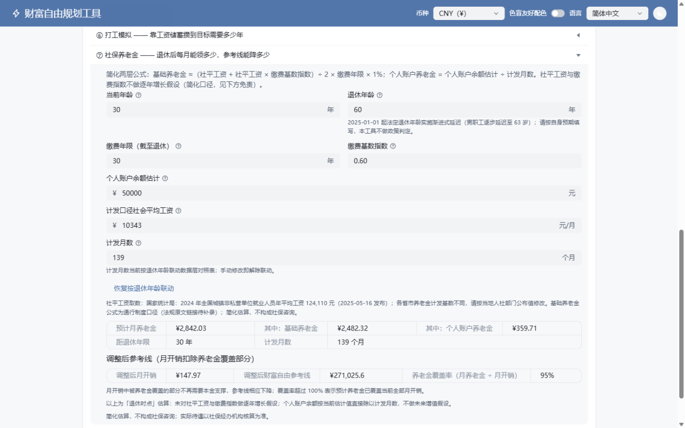 | 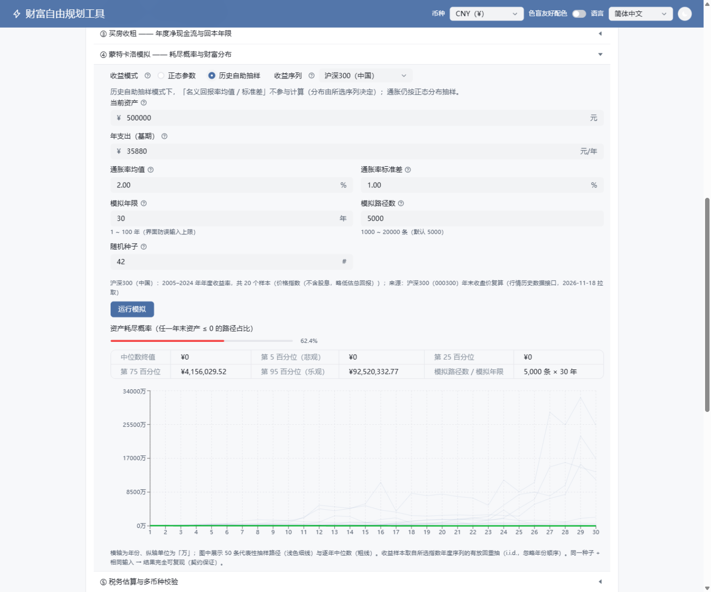 |
| *面板⑦默认输入（30 岁 / 60 岁退休 / 30 年缴费 / 指数 0.6 / 账户余额 5 万 / 社平 10,343 / 计发月数 139）：预计月养老金 ¥2,842.03（基础 ¥2,482.32 + 个人账户 ¥359.71），覆盖率 95%；调整后月开销 ¥147.97，调整后参考线 ¥271,025.6；面板底部固定注明「简化估算，不构成社保咨询」* | *收益模式切「历史自助抽样」（序列：沪深300，2005–2024 年度收益率 20 个样本，价格指数口径）：名义回报率均值 / 标准差两字段隐藏并注明不参与计算；同一输入与种子 42 运行 → 资产耗尽概率 62.4%、中位数终值 ¥0、第 75 百分位 ¥4,156,029.52、第 95 百分位 ¥92,520,332.77（正态参数模式同输入为 94.4%，见下方标注截图）；同一种子 + 相同输入可复现（契约保证）* |

| 蒙特卡洛 · 支取策略（阈值带调整演示） | 序列风险对照 · 起点滚动命运曲线 |
| --- | --- |
| 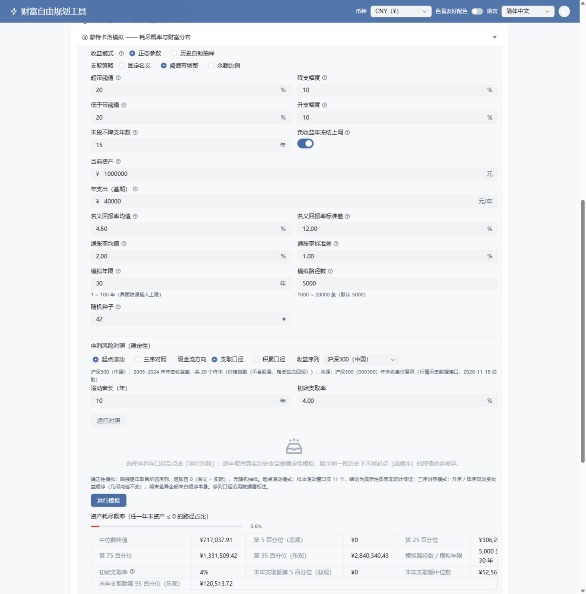 | 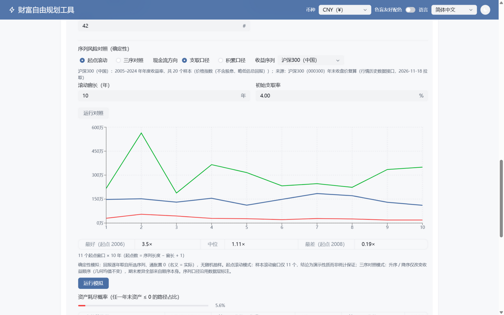 |
| *支取策略切「阈值带调整」（默认参数：超带阈值 20% / 降支幅度 10% / 低于带阈值 20% / 升支幅度 10% / 末段 15 年不降支 / 负收益年冻结上调开）：当前资产 ¥1,000,000、年支出 ¥40,000（初始支取率 4%）、名义回报 4.5% ± 12%、通胀 2% ± 1%、30 年、5,000 条路径、种子 42 → 资产耗尽概率 5.6%，结果行新增「初始支取率」与「末年支取额」分位数（第 5 百分位 ¥0 / 第 95 百分位 ¥120,513.72）；同图下方「序列风险对照」子区未运行时以空态组件展示引导文案* | *「序列风险对照（确定性）」子区运行起点滚动：支取口径、沪深300（2005–2024 年度收益率 20 个样本）、窗长 10 年、初始支取率 4% → 最好（起点 2006）3.5× / 中位 1.11× / 最差（起点 2008）0.19× 三条命运曲线；下方如实标注「11 个起点窗口 × 10 年」，口径注写明通胀置 0（名义 = 实际）、窗口数有限结论为演示性质* |

| ⑧ 多情景对比 · 场景库并排对比 | 打工模拟 · 反推储蓄模式（⑥ 号面板） |
| --- | --- |
| 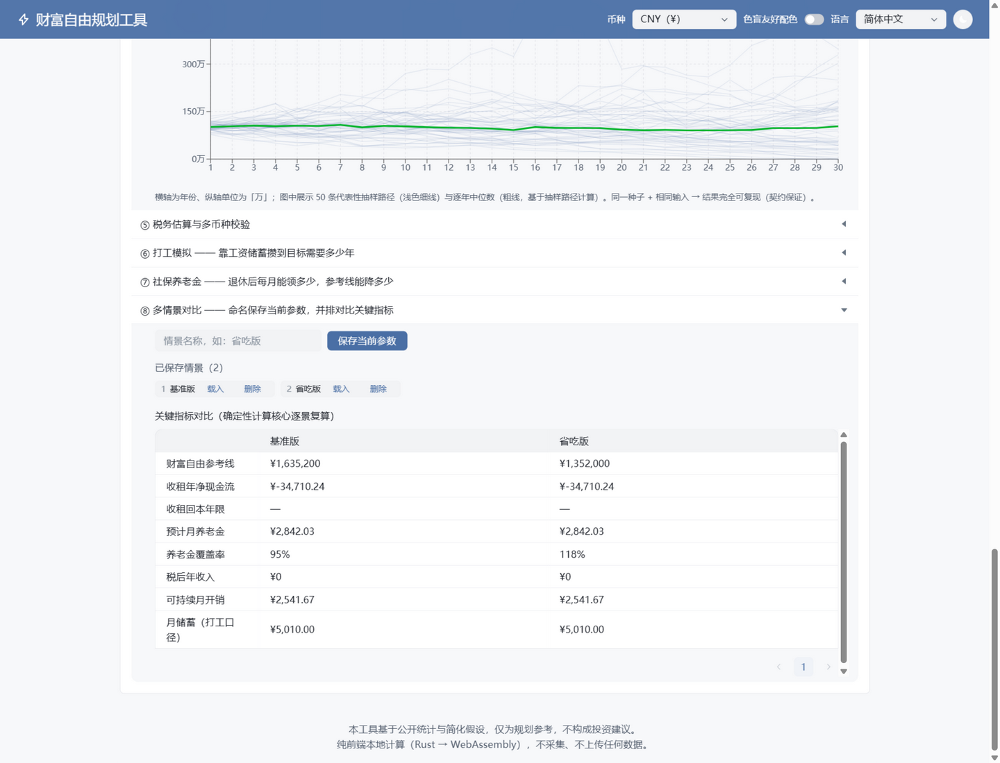 | 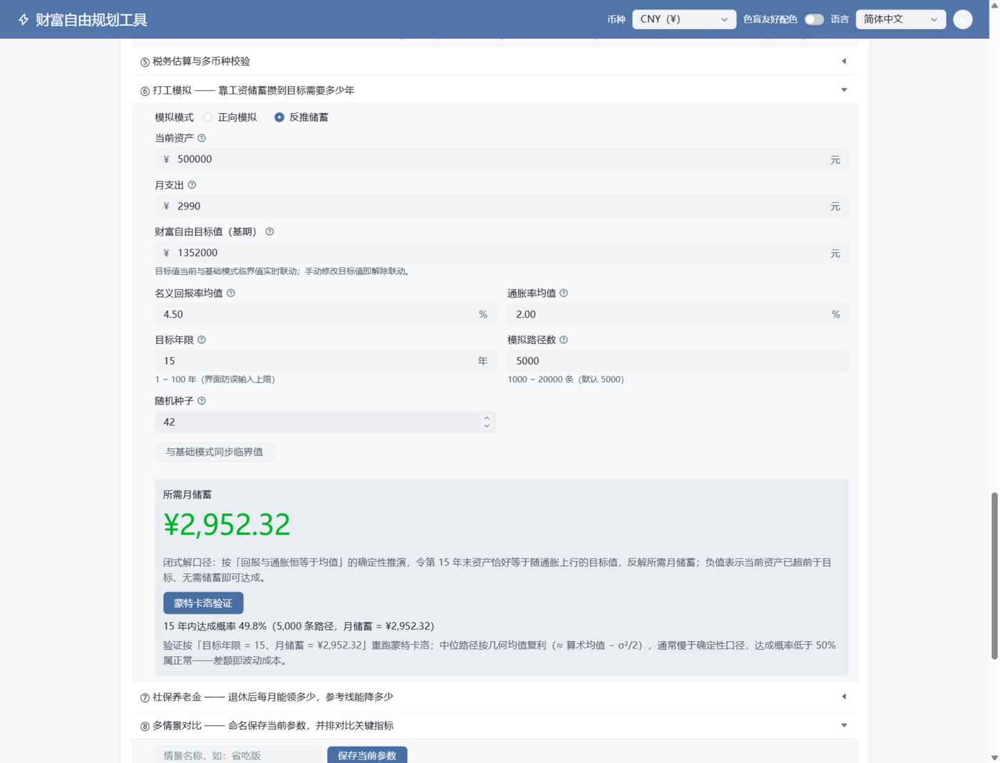 |
| *面板⑧保存「基准版」「省吃版」两个情景后并排对比 8 项关键指标：财富自由参考线 ¥1,635,200 vs ¥1,352,000、养老金覆盖率 95% vs 118%，其余指标（收租年净现金流 −¥34,710.24、预计月养老金 ¥2,842.03、可持续月开销 ¥2,541.67、月储蓄 ¥5,010.00 等）在这两个情景间相同；对比表由确定性计算核心逐景复算，情景以分享链接编码存入浏览器本地场景库（上限 12 个），每条带载入 / 删除* | *面板⑥模拟模式切「反推储蓄」：当前资产 ¥500,000、目标值 ¥1,352,000（与基础模式临界值实时联动）、目标年限 15 年 → 闭式解反解所需月储蓄 ¥2,952.32（口径注：按「回报与通胀恒等于均值」的确定性推演，负值表示无需储蓄即可达成）；点「蒙特卡洛验证」→ 15 年内达成概率 49.8%（5,000 条路径），并注明中位路径按几何均值复利、通常慢于确定性口径，低于 50% 属正常——差额即波动成本* |

| 公式原理与数据依据（⑨ 号面板） | 反向估算 · 演示算例（① 号面板） |
| --- | --- |
|  | 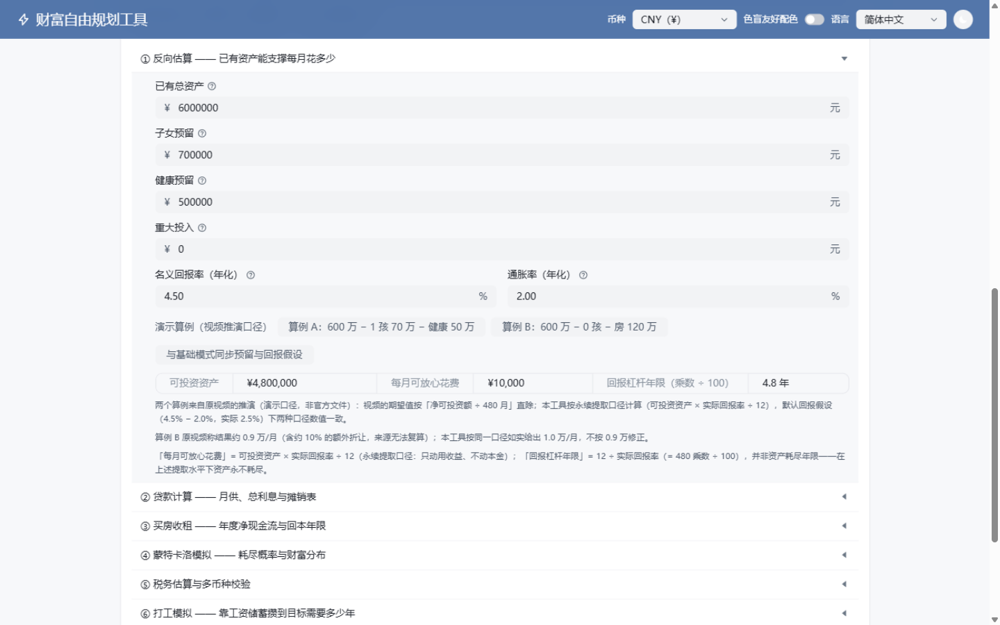 |
| *面板⑨展开态：公式推导（资产 = 月开销 × 12 ÷ r，r = 2.5% 时 12 ÷ 0.025 = 480）＋「假设链条：从存款利率到乘数 480」——一年期定存挂牌利率 0.95% → 五年期 1.30% → 核心通胀 1.2% → 社保基金年均 7.39% → 企业年金年均 6.17% → 综合损耗 → 名义 / 通胀假设 → 实际回报 → 乘数 480，逐环附「来源；年份；口径」与三级核证标注（官方核证 / 媒体核证 / 视频口径），「视频口径」条目不参与计算；面板下方另有直观换算锚点、市场平均消费、分城市育儿成本、医疗支出参考与严格版 vs 宽松版口径说明* | *面板①「演示算例（视频推演口径）」按钮组：点「算例 A：600 万 − 1 孩 70 万 − 健康 50 万」一键填入（总资产 ¥6,000,000 / 子女预留 ¥700,000 / 健康预留 ¥500,000，回报假设同步为 4.5% − 2.0%）→ 可投资资产 ¥4,800,000、每月可放心花费 ¥10,000、回报杠杆年限 4.8 年；注行如实说明算例来自原视频推演（演示口径，非官方文件），算例 B 原视频称约 0.9 万/月（含约 10% 不可复算折让），本工具按同一口径如实给出 1.0 万/月、不按 0.9 万修正* |

| 月开销敏感性 · 欲望对自由的影响 | 场景分享 · 一条链接带走全部参数 |
| --- | --- |
| 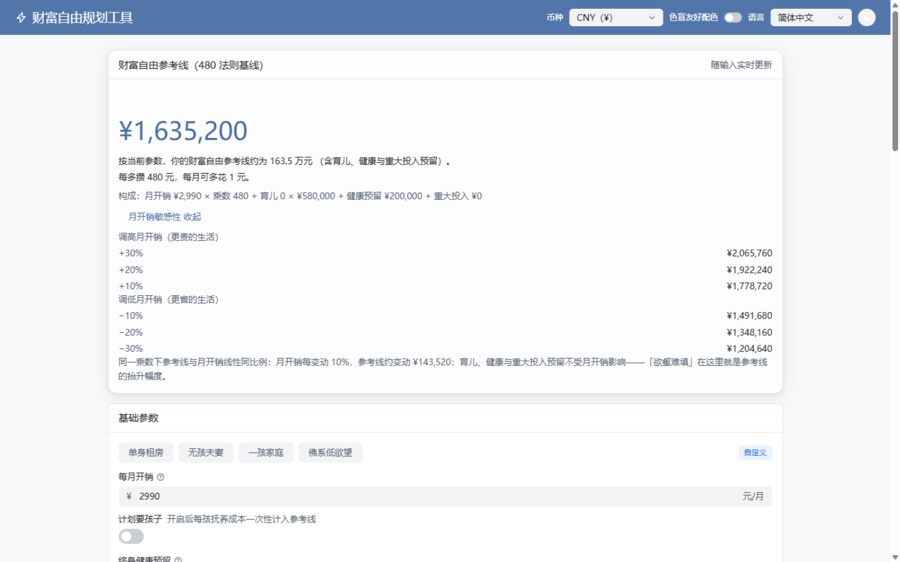 |  |
| *输出卡点「展开」：调高 / 调低月开销各三档参考线逐档刷新（默认参数下 +10% 档 ¥1,778,720、−10% 档 ¥1,491,680），说明行给出「月开销每变动 10%，参考线约变动 ¥143,520」；修改月开销时六档数值防抖跟随* | *点「复制分享链接」→ 提示「分享链接已复制到剪贴板」：全部业务输入（不含主题 / 语言 / 币种等界面偏好）编码进 URL hash，粘贴给他人打开即为同一套参数；损坏或版本不符的链接回落默认参数并提示* |

| 预设场景 · 一键填入生活画像（截图同时展示自由刻度进度环） | 打工模拟 · 靠工资储蓄攒到目标要几年（⑥ 号面板） |
| --- | --- |
| 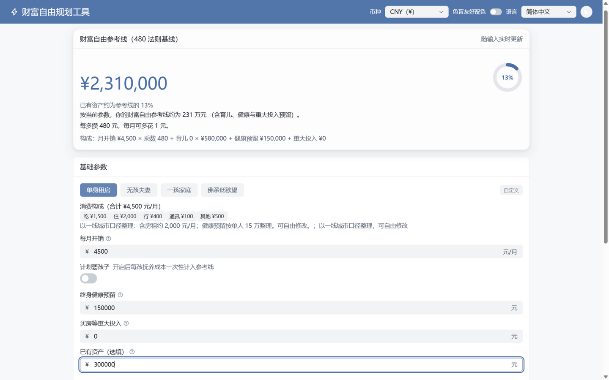 | 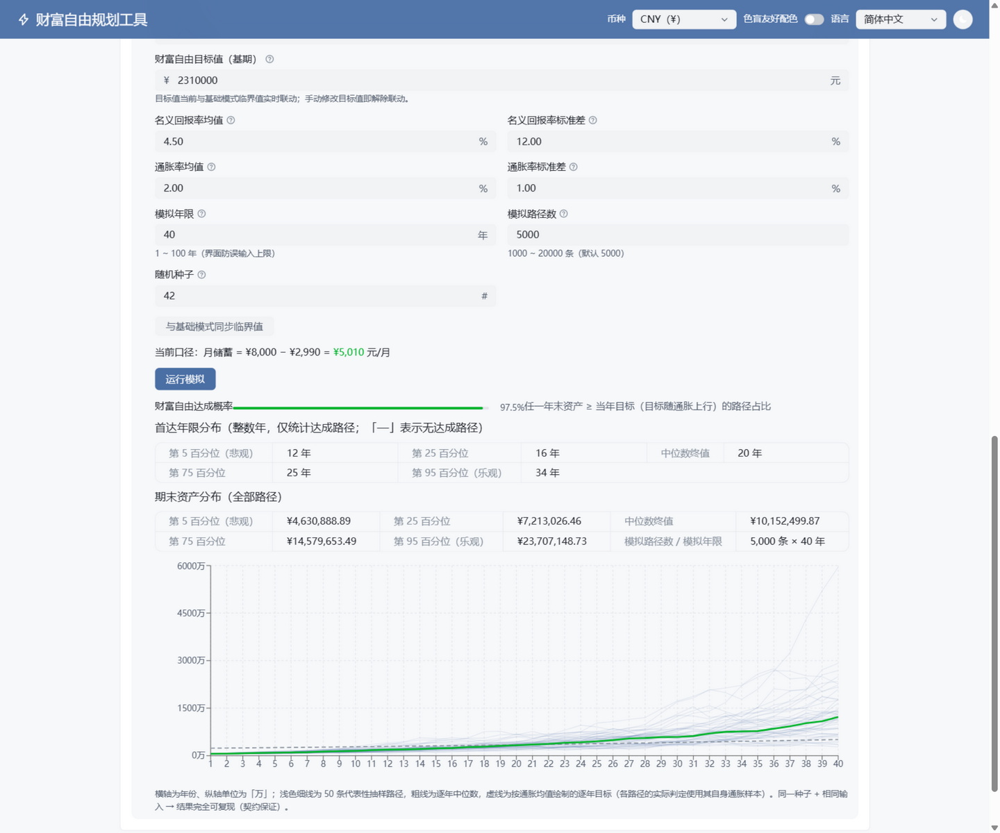 |
| *点击「单身租房」画像：月开销 ¥4,500、健康预留 ¥150,000 一次填入，参考线更新为 ¥2,310,000；按钮下方以只读 Tag 展示消费构成（合计 ¥4,500 元/月：吃 ¥1,500 / 住 ¥2,000 / 行 ¥400 / 通讯 ¥100 / 其他 ¥500）；在「已有资产（选填）」填入 ¥300,000 后，大字号旁出现进度环并标注「已有资产约为参考线的 13%」* | *面板⑥默认输入（当前资产 ¥500,000、税后月收入 ¥8,000、月支出 ¥2,990，月储蓄 ¥5,010），目标值与基础模式临界值实时联动为 ¥2,310,000：5,000 条路径 × 40 年（种子 42）给出达成概率 97.5%、首达年限分位（第 5/25/50/75/95 百分位 = 12/16/20/25/34 年）与期末资产分布（中位数 ¥10,152,499.87）；折线图为 50 条抽样路径 + 中位数粗线 + 按通胀均值上行的目标虚线，同一种子 + 相同输入可复现* |

| 深色主题首屏 | 首屏（红框标注） |
| --- | --- |
| 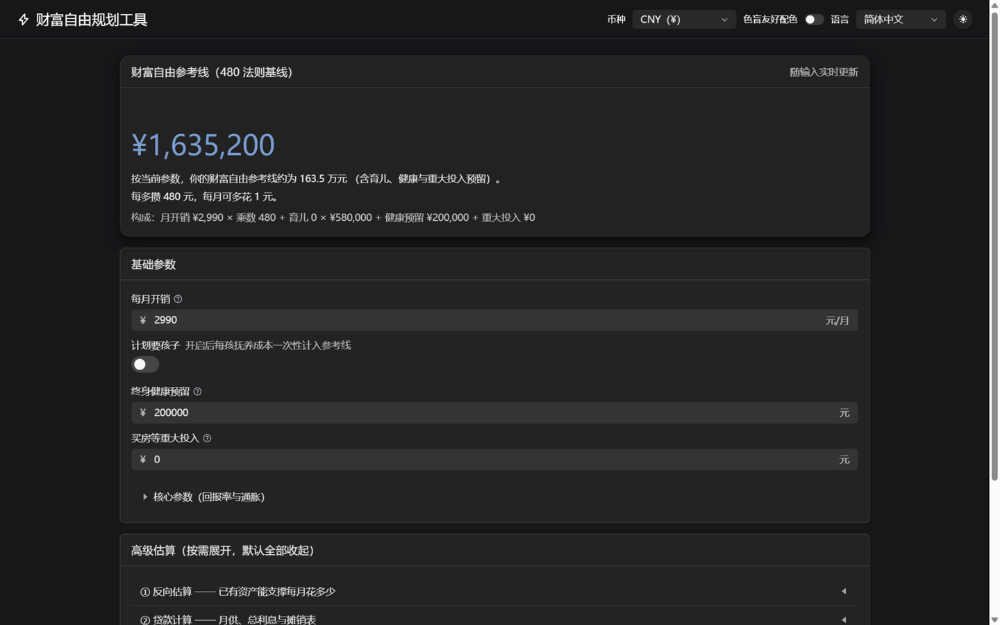 | 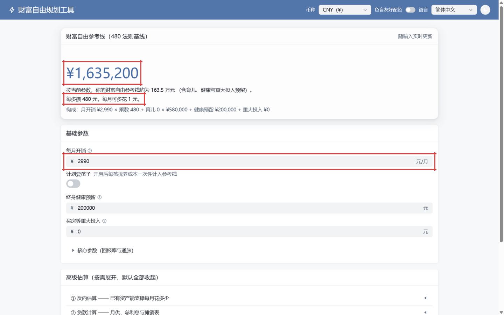 |
| *同一套默认参数（¥1,635,200 ≈ 163.5 万）：页面底色、三层表面材质、文字分级与语义色整体切换为深色令牌组；顶栏按钮一键切换，详见「设计体系」* | *红框：每月开销输入 → 临界值大字号输出（默认参数 ¥1,635,200 ≈ 163.5 万）→「每多攒 480 元，每月可多花 1 元」联动换算* |

| 蒙特卡洛结果（红框标注） |
| --- |
| 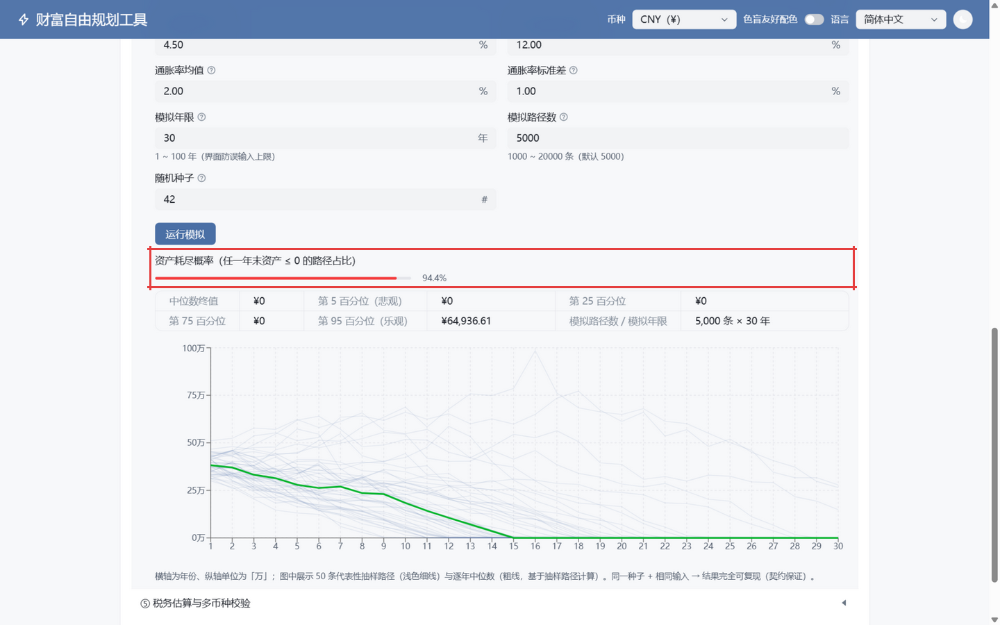 |
| *红框：资产耗尽概率 94.4%——50 万资产、每年支出约 3.6 万（约 7.2% 提取率）的保守情形；下方为分位数终值行与 50 条样本路径 + 中位数曲线（默认输入：4.5% ± 12%、通胀 2% ± 1%、30 年、5,000 条、种子 42）* |

| ① 反向估算 | ② 贷款计算 |
| --- | --- |
| 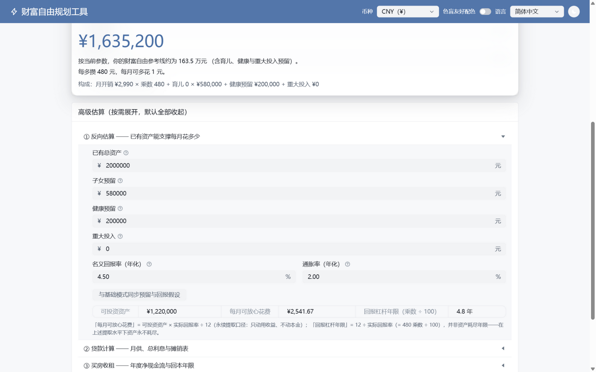 | 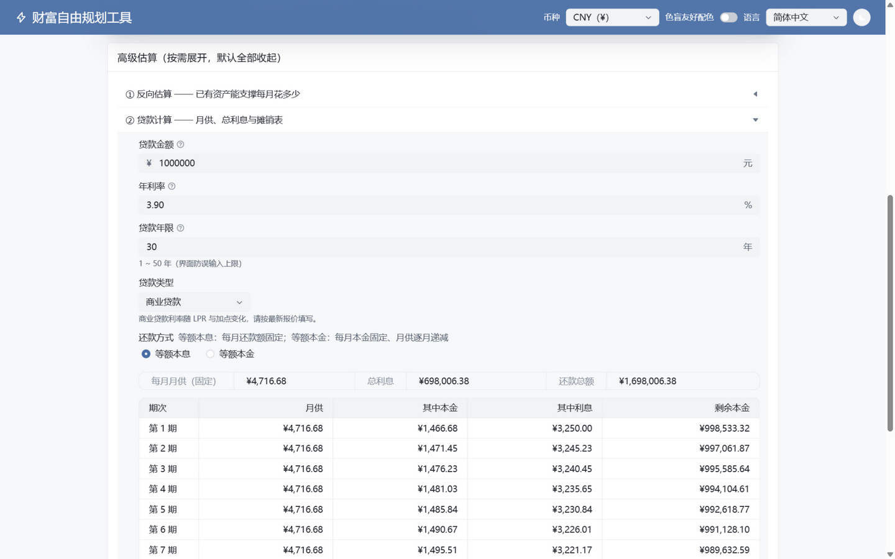 |
| *面板默认输入（总资产 200 万、子女预留 58 万、健康预留 20 万）→ 可投资产 ¥1,220,000 → 每月可放心花费 ¥2,541.67（永续提取口径，面板内注明；另给回报杠杆年限 4.8 年）* | *100 万 / 3.9% / 30 年等额本息：月供 ¥4,716.68、总利息 ¥698,006.38、还款总额 ¥1,698,006.38，附逐期摊销表；贷款类型可选，利率按最新市场报价自行填写* |

| ③ 买房收租（面板默认参数） | ⑤ 税务估算（中国） |
| --- | --- |
| 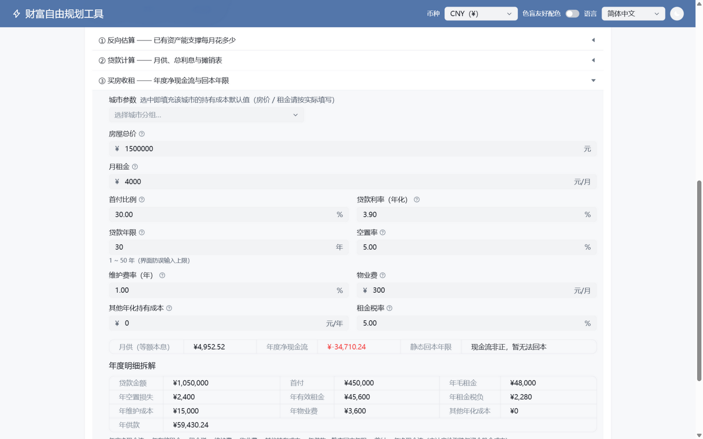 | 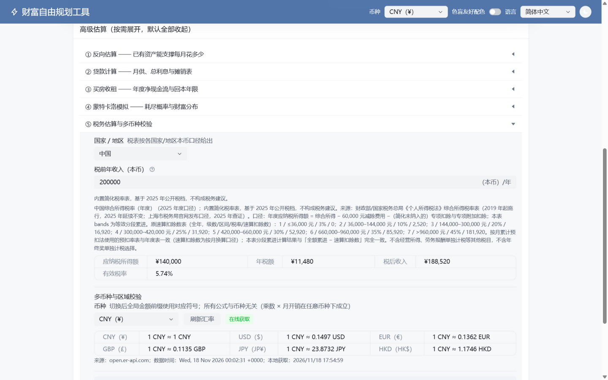 |
| *默认参数（房价 150 万、月租 4,000、首付 30%、利率 3.9%、30 年、空置 5% 等）：月供 ¥4,952.52，年度净现金流 −¥34,710.24 以红色如实警示，回本年限如实显示「现金流非正，暂无法回本」* | *年入 20 万 → 应纳税所得额 ¥140,000、年税额 ¥11,480、税后 ¥188,520、有效税率 5.74%；税表来源、口径与速算扣除数全文随面板展示* |

| 多币种（美元） | 移动端 375px |
| --- | --- |
| 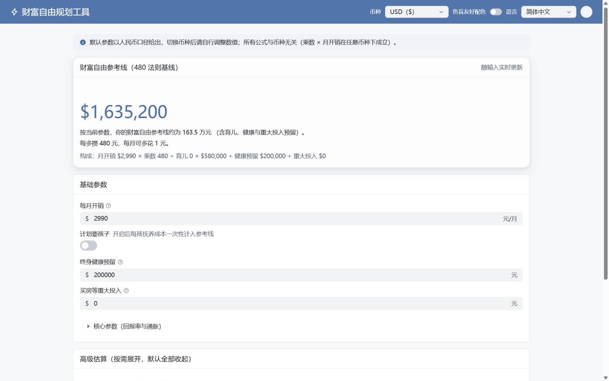 | 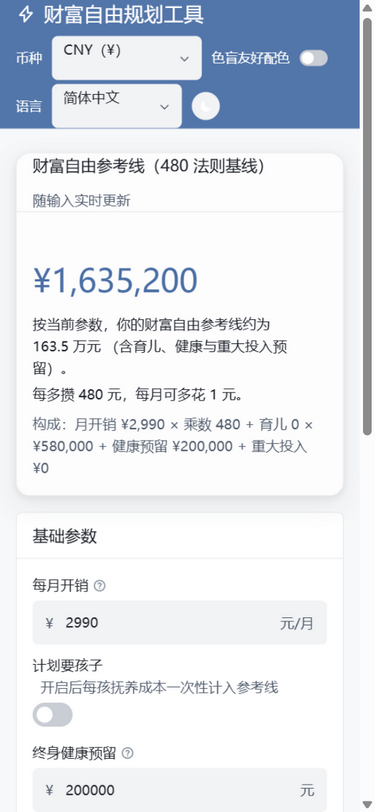 |
| *顶栏切换币种（CNY → USD）后全局金额符号联动，同时以非阻断提示说明「默认参数以人民币口径给出」，所有公式与币种无关* | *单列布局、顶栏工具组自动换行、金额不断行、无横向溢出* |

| ③ 买房收租 · 城市分组直选（选项右侧小字为示例城市） | 选中「国际 · 全球金融中心」后（组内区间 + 代表城市 + 分级口径） |
| --- | --- |
| 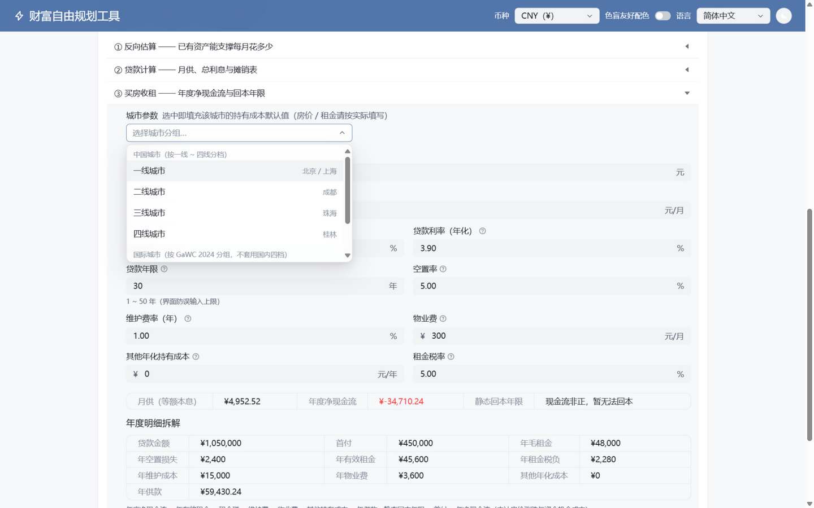 | 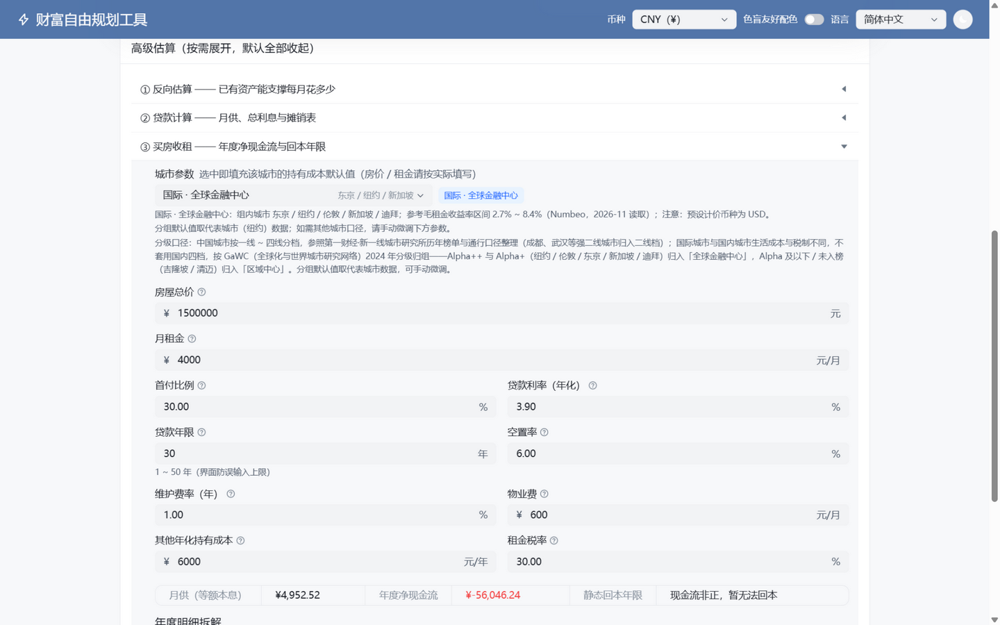 |
| *两个分区：中国城市按一线 ~ 四线分档（选项右侧小字标注示例城市，如 一线：北京 / 上海）；国际城市不套用国内四档，按 GaWC 2024 归组（下拉底部注明）——用户按示例城市对号入座* | *选中分组后展示：组内城市（东京 / 纽约 / 伦敦 / 新加坡 / 迪拜）与参考毛租金收益率区间（2.7% ~ 8.4%，Numbeo，2026-11 读取）、预设币种提示、代表城市（纽约）默认值与分级口径说明* |

| 界面语言 · 繁體中文（逐词繁体字形） | 界面语言 · English |
| --- | --- |
| 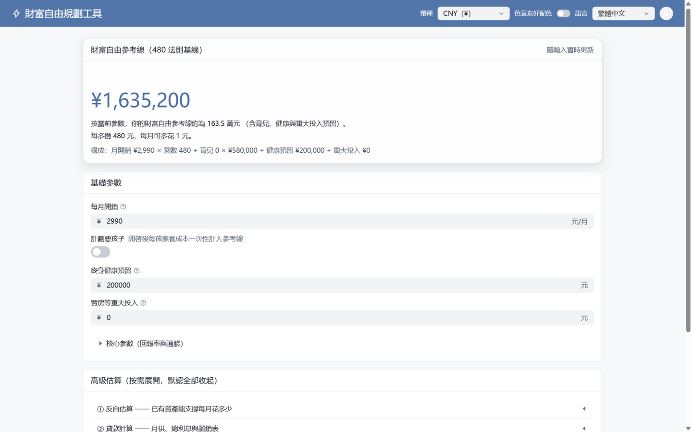 | 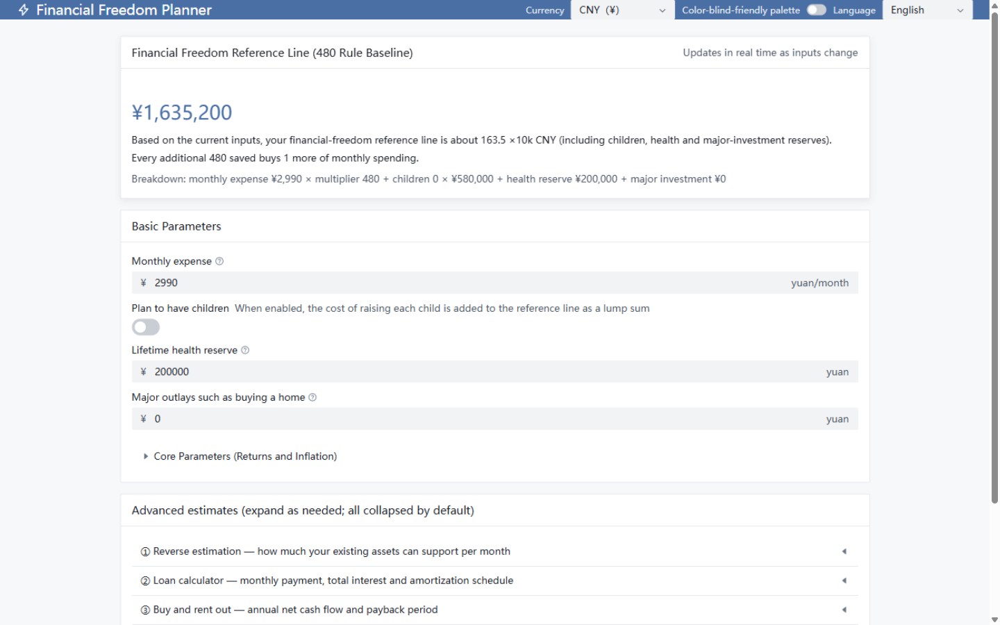 |
| *繁体为与简体**逐词对应的字形转换**（Traditional Chinese，zh-Hant，字形之分而非地区之分），如 參考線 / 每月開銷 / 實時，不做地区词汇改写* | *完整英文界面（简体中文 / 繁體中文 / English 三语切换，语言偏好持久化、首次访问按浏览器语言自动选择）* |

| PWA 安装 · 应用清单核验（DevTools 中文界面） |
| --- |
| 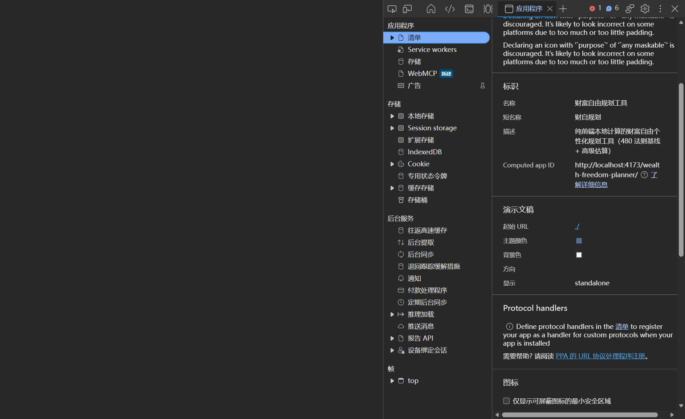 |
| *DevTools「应用程序 → 清单」面板核验构建产物：名称「财富自由规划工具」、短名称「财自规划」、起始 URL `./`、显示 standalone；Service Worker（`src/sw.ts` 手写）预缓存全部本地资源（含 WASM 计算核心），安装到桌面 / 主屏后可离线使用；版本更新静默换版（autoUpdate），无更新弹窗* |

> [!NOTE]
> 完整逐屏素材（含移动端蒙特卡洛图表 `demo-mobile-montecarlo.png`）位于 `docs/assets/`，均为可复现的构建产物截图。

## ✨ 功能特性

| 功能 | 状态 | 说明 |
| --- | :-: | --- |
| 480 法则基线计算 | ✅ 已实现 | 乘数、临界值实时联动；实际回报率 ≤ 0 时明确报错，不静默给数 |
| 公式原理与数据依据 | ✅ 已实现 | 面板⑨：公式推导（资产 = 月开销 × 12 ÷ r，r = 2.5% 时 12 ÷ 0.025 = 480）、假设链条表（存款挂牌利率 → 核心通胀 → 社保基金年均 7.39% → 企业年金年均 6.17% → 综合损耗 → 名义 / 通胀假设 → 实际回报 → 乘数 480，逐环附来源 / 年份 / 口径与「官方核证 / 媒体核证 / 视频口径」三级标注）、直观换算锚点、市场平均消费参考（2025 全国 2,456 / 城镇 2,989 元/月）、分城市育儿成本（《中国生育成本报告（2024 版）》原文值）与医疗支出参考、严格版 vs 宽松版口径说明；「视频口径」条目如实标注、不参与任何计算 |
| 反向估算 | ✅ 已实现 | 已有资产扣除预留后，反推可放心花费的月支出（永续提取口径 + 回报杠杆年限，面板内注明） |
| 贷款测算 | ✅ 已实现 | 贷款类型可选（利率按最新市场报价自行填写）；等额本息 / 等额本金，逐期摊销表 + 总利息与还款总额 |
| 买房收租分析 | ✅ 已实现 | 年度净现金流 + 回本年限；城市参数分**中国城市 / 国际城市**两个分区直选：中国按**一线 ~ 四线**分档，国际按 **GaWC 2024** 归组（不套用国内四档）；选中分组即套用代表城市参数，并展示组内城市、参考收益率区间与分级口径（数据含来源标注） |
| 界面语言 | ✅ 已实现 | **简体中文 / 繁體中文 / English** 三语切换（语言偏好持久化，首次访问按浏览器语言自动选择；组件库语言随之联动） |
| 深浅色双主题 | ✅ 已实现 | 首次访问跟随系统偏好；顶栏按钮手动切换并持久化（显式选择后优先于系统）；页面底色、三层材质、图表与语义色整体换装；系统「减弱动效」偏好下瞬时切换 |
| 蒙特卡洛模拟 | ✅ 已实现 | 默认 5,000 条路径；固定随机种子可复现；耗尽概率、中位数与 5/25/75/95 分位数终值 + 50 条样本路径图 |
| 预设场景 | ✅ 已实现 | 基础参数卡内置 4 组生活画像（单身租房 / 无孩夫妻 / 一孩家庭 / 佛系低欲望），一键填入全套基础参数并以只读 Tag 展示消费构成；手动修改任一输入自动切回「自定义」 |
| 自由刻度 | ✅ 已实现 | 填写「已有资产」后，参考线大字号旁展示 SVG 进度环（资产 ÷ 临界值，百分比居中），并标注「已有资产约为参考线的 X%」 |
| 打工模拟 | ✅ 已实现 | 给定税后月收入与月支出，按名义回报 + 通胀双随机模拟攒钱路径：财富自由达成概率、首达年限分位（P5–P95）、期末资产分布与 50 条路径图；目标随通胀水涨，同种子可复现 |
| 社保养老金估算 | ⚠️ 简化实现 | 简化两层公式（基础养老金 + 个人账户）估算退休后月养老金：当前/退休年龄、缴费年限与缴费基数指数、个人账户余额估计、计发口径社平工资；输出「调整后参考线」——月开销中被养老金覆盖的部分不再需要本金支撑；社平工资与缴费指数不做逐年增长假设、账户余额不做未来增值假设；面板内固定注明「简化估算，不构成社保咨询」 |
| 历史自助抽样（蒙特卡洛收益模式） | ✅ 已实现 | 蒙特卡洛收益模式可选：正态参数（经典口径）或从沪深300 / 标普500 真实年度收益序列有放回重抽样（i.i.d.，保留真实肥尾与偏度，忽略年份顺序）；统计与图表口径与正态模式一致，同种子可复现 |
| 动态支取策略（蒙特卡洛） | ✅ 已实现 | 三类支取规则可选：固定名义（随通胀上行，默认）/ 阈值带调整（支取率偏离初始支取率 ±20% 触发 ±10% 修正、末段 15 年不再降支、负收益年冻结上调，参数均可调）/ 余额比例（按当前余额按实际回报假设年金化摊还到规划终点，可选支出地板与上限，构造上不破产）；输出末年支取额分位数衡量购买力风险；同种子可复现 |
| 序列风险对照 | ✅ 已实现 | 基于沪深300 / 标普500 真实年度收益序列的确定性模拟（无随机）：起点滚动（每起点各回测一遍，展示最好 / 中位 / 最差三条终值命运曲线 + 窗口数标注）与三序对照（同一序列原始 / 升序 / 降序，几何均值不变、期末差异全部来自顺序）；通胀置 0（名义 = 实际），窗口数有限如实标注为演示性质 |
| 多情景对比器 | ✅ 已实现 | 把当前全部业务输入（复用分享链接编码，含版本校验）命名保存到浏览器本地场景库（上限 12 个），并排对比财富自由参考线、收租现金流、养老金、税后收入、月储蓄等关键指标（确定性计算核心逐景复算，毫秒级） |
| 目标日期反推（打工模拟） | ✅ 已实现 | 给定目标年限，按「回报与通胀恒等于均值」的确定性口径闭式解反推所需月储蓄（可为负 = 无需储蓄）；一键「蒙特卡洛验证」给出目标年限内达成概率，并注明波动成本（中位路径按几何均值复利，通常慢于确定性口径） |
| 敏感性龙卷风图与收租瀑布图 | ✅ 已实现 | 月开销敏感性升级为龙卷风图（按偏离降序 + 基准参考线 + 方向双色，图下保留数值行作数据表替代）；收租年度明细新增瀑布图（毛租金 → 逐项扣减 → 净现金流桥接，三角色配色 + 虚线连接线，窄屏自动回退明细表）；全部图表深浅色双参数与 aria 汇总句，未运行空态改用标准空态组件 |
| 欲望敏感性（月开销敏感性小节） | ✅ 已实现 | 基础输出卡的「月开销敏感性」小节可展开：±10% / ±20% / ±30% 三档月开销对应的财富自由参考线（复用基线计算逐档调用、展开才计算），量化「欲望对参考线的抬升幅度」 |
| 场景分享链接 | ✅ 已实现 | 「复制分享链接」把全部业务输入（基础 / 反向 / 贷款 / 收租 / 蒙特卡洛 / 打工 / 税务 / 进度环 / 养老金）编码进 URL hash（版本号 + base64url）；打开链接自动恢复，损坏或版本不符回落默认参数并提示 |
| 税务估算 | ⚠️ 简化实现 | 8 国/地区 2025 简化税档（中国/美国联邦/英国/德国/日本/新加坡/澳大利亚/加拿大）；**不含**社保、专项附加扣除、地方税等明细 |
| 多币种 | ⚠️ 简化实现 | 在线时经 open.er-api.com 免费接口获取实时汇率（免密、显示时间戳）；**离线快照当前为占位**（见已知局限） |
| 响应式设计 | ✅ 已实现 | 断点矩阵 **375 / 640 / 768 / 1024 / 1440**（768 为唯一硬断点，顶栏收纳档实测上界 789.9）：顶栏三档收纳（窄档文字标签视觉隐藏、保留读屏语义与 aria-label，Select 缩宽并以短形态显示当前值）、底部吸附操作条（复制分享常驻窄屏拇指自然可达区，蒙特卡洛「运行模拟」面板尾部 sticky 落位）、窄屏表格首列 sticky + 右缘渐隐 + 滑动提示、输出卡紧凑模式（构成明细摘要 + 展开、进度环 56px）、图表高度三档（240 / 280 / 320）与紧凑档 X 刻度精简；触控目标规范：交互控件最小 44px（预设按钮、折叠面板头、mini 操作按钮扩展命中区），删除情景等破坏性操作二次确认 |
| 色盲友好模式 | ✅ 已实现 | 高区分度蓝/橙替代色板替换绿/红语义色（深浅两主题各有一组适配值） |
| PWA 离线安装 | ✅ 已实现 | 构建产物含 Web App Manifest 与手写 Service Worker（`src/sw.ts`）：预缓存全部本地资源（含 WASM 计算核心），可安装到桌面 / 主屏，安装后离线使用；版本更新静默换版（autoUpdate），无更新弹窗、无打断 |
| 无障碍支持 | ✅ 已实现 | 键盘可达：「跳转到主内容」链接、折叠头焦点环、字段提示图标可聚焦弹出说明；读屏：banner / main / contentinfo 地标、字段标签程序关联（aria-labelledby / describedby）、结果落定值 polite 播报、图表附 aria 摘要句与可见数据表；对比度按 AA 阈值（正文 ≥ 4.5:1）以令牌级审计脚本核查（`npm run check:a11y`），浅色个别语义色的现状豁免在规范中如实登记 |
| 场景导出 PNG | ✅ 已实现 | 「多情景对比」面板一键把关键指标对比表导出为 PNG（原生 Canvas 手绘，零新增依赖）；配色取当前生效主题令牌（含色盲友好档），文案随界面语言；无有效情景时按钮禁用 |
| 账户系统 / 云同步 / 实盘行情 | ❌ 不具备 | 纯本地静态应用，刻意不做后端；不接入任何行情通道 |

> 输入约束：金额 0 ~ 10 亿（整数、步进 100）、百分比 0.01% ~ 30%、路径数 1000 ~ 20000；非法输入明确报错而非静默修正。支取策略 / 序列风险对照 / 反推储蓄等新增字段按各自面板标注的限域校验，越界同样报错。

## 🧰 技术栈

| 层 | 选型 |
| --- | --- |
| 框架 | React 18 + Vite 6 + TypeScript（`strict`） |
| UI 组件 | `@arco-design/web-react`（组件库，含内置图标） |
| 状态管理 | zustand |
| 图表 | recharts（仅高级模式蒙特卡洛面板使用） |
| 国际化 | i18next + react-i18next（三份语言资源键集一致） |
| 计算核心 | Rust → WASM（wasm-pack `--target web`，JSON 进 JSON 出）：金额运算 `rust_decimal`（`arbitrary_precision` 精确解析，无 f64 中转）、摊销参考 `rust_finprim`、随机抽样 `rand` + `rand_distr` |

## 🚀 快速开始

前置依赖：Node.js ≥ 18（含 npm）、Rust 工具链与 `wasm32-unknown-unknown` 目标、`wasm-pack`（`cargo install wasm-pack --locked` 或从 [rustwasm.github.io](https://rustwasm.github.io/wasm-pack/installer/) 安装）。

```bash
npm install
# 构建计算核心（产物输出到 src/wasm/pkg/，已随仓库入库，跳过此步也可直接运行）
wasm-pack build src/wasm --target web --out-dir pkg --release
npm run dev       # 开发服务器
```

构建与检查：

```bash
npm run build        # tsc --noEmit && vite build（类型检查 + 产物构建，输出 dist/）
npm run preview      # 本地预览构建产物
npm run check:size   # 尺寸门禁：dist 总和 ≤ 2MB 且最大 .wasm ≤ 800KB，超标 exit 1
cargo test --manifest-path src/wasm/Cargo.toml   # 计算核心单元/集成测试
```

> [!NOTE]
> 测试包含两条关键回归锁定：蒙特卡洛**同一输入 + 同一种子输出逐字节一致**（确定性），以及名义口径递推的**闭式解已知值**校验。

## 🎨 设计体系

界面按一份可直接施工的设计规范实现：设计令牌、组件规则、动效清单、无障碍数值口径与逐项验收清单见 [docs/design-spec.md](docs/design-spec.md)。规范参数经由对业界主流设计规范的系统对照审计校准（对照过程与复算数值见 [docs/design-research.md](docs/design-research.md)）。要点：

- **设计令牌**：全部样式经 `--wf-` CSS 变量与 `wf-` 类名前缀组织，分为与主题无关的静态层（8pt 间距、圆角、字阶、动效时长与曲线）和随主题切换的动态层（页面底色、文字分级色、材质、发丝线、阴影、焦点环、语义色、图表色）。令牌的单一事实来源在 `src/data/defaults.ts`（浅色组 `THEME` / 深色组 `THEME_DARK` 同键双值），运行时注入文档根节点；样式表默认值与注入值逐键一致，配合 `index.html` 的首帧守卫脚本防止主题闪变。
- **三层表面材质**：顶栏、悬浮输出卡、浮层三个层级均由「半透明底色 → 背景模糊 + 提饱和 → 1px 发丝线 → 阴影令牌」四要素构成，模糊半径承载层级语义（两主题取值一致），普通内容卡片保持实底不参与材质；深色下的材质透明度按「最不利透底对比度」口径定值，不是自由参数。
- **动效与触控**：动效只用于传达状态变化——时长三档（120 / 240 / 360ms）与三族曲线（标准 / 强调 / 渐近）全部走令牌，禁止组件内裸写字面量；入场动效只在首次出现时播放，同屏同时进行的动效不超过两个；按压反馈（缩放 + 透明度）、`:focus-visible` 焦点环按表面选变体、最小 44px 触控目标。
- **深浅色双主题**：首次访问跟随系统偏好（`prefers-color-scheme`）；顶栏按钮手动切换并写入 localStorage 持久化，显式选择后优先于系统偏好；`data-theme` 属性恒置可查，浏览器地址栏主题色（theme-color）同步更新；普通卡片、弹层等组件库表面的深色适配由组件库主题机制承载，品牌主色阶两主题恒定。
- **无障碍与自动降级**：系统开启「减弱动效」后，CSS 过渡全停、数值直接落值、图表免动画成图、主题切换瞬时完成（CSS + JS 双通道）；文字对比度按「常态合成底 / 最不利透底」双口径实测（深色全组 ≥ 4.5:1；浅色个别语义色的现状豁免在规范中如实登记，不假性达标）。

## 📦 部署到 GitHub Pages

```bash
bash scripts/deploy.sh
```

脚本按序执行：`npm run build` → `cd dist && touch .nojekyll` → `git add -A && git commit` → `git push origin HEAD:gh-pages --force`。实现上 `dist/` 以内嵌独立 git 仓库承载部署快照（树根即 `index.html` 与 `.nojekyll`），因此 Pages 的 `/ (root)` 设置可直接命中。

GitHub Pages 设置（一次性，仓库 Settings → Pages）：

- **Source**: Deploy from a branch
- **Branch**: `gh-pages`
- **Folder**: `/ (root)`

> [!IMPORTANT]
> 首次部署前需要先添加远端：`git remote add origin <你的仓库地址>`。本仓库**刻意不创建 `.github/workflows`**，部署全部在本地由脚本完成。

## 📊 数据来源与口径

| 数据 | 来源 | 年份 / 查证 | 口径要点 |
| --- | --- | --- | --- |
| 中国个税 | 财政部/国家税务总局《个人所得税法》综合所得税率表（上海市税务局官网发布口径） | 2025 年延续，2026-11 查证 | 6 万元/年减除费用；速算扣除数表已换算为等效分段累进；**不含**专项扣除与专项附加扣除 |
| 美国联邦等 7 国税档 | IRS Rev. Proc. 2024-40、GOV.UK、德国 §32a EStG、日本国税庁、IRAS、ATO、CRA | 2025 | 各表 `note` 字段注明本币口径与未纳入项 |
| 城市租金收益率 | Numbeo 城市房产页（滚动 18 个月窗口） | 2026-11 读取，基准年 2025 | 毛收益率（年租金 ÷ 房价）；持有成本为市场惯例整理值（见各城市 `note`） |
| 城市分组 | 中国：第一财经·新一线城市研究所历年榜单与通行口径整理（按一线 ~ 四线分档）；国际：GaWC（全球化与世界城市研究网络）2024 年分级归组（不套用国内四档） | 2024 分类，2026-11 查证 | Alpha++ 与 Alpha+ → 全球金融中心；Alpha 及以下 / 未入榜 → 区域中心；国际城市生活成本与税制口径独立，不与国内城市直接横比 |
| 人均 GDP(PPP) / 消费率 | 世界银行 API（NY.GDP.PCAP.PP.CD / NE.CON.PRVT.ZS） | 2024 年值，2026-11-11 快照 | 全国口径，仅作经济体量参考 |
| 居民消费 / 恩格尔系数（中国） | 国家统计局《2024 年居民收入和消费支出情况》 | 2025-01-17 发布 | 城镇人均消费支出 34,557 元/年 ≈ 2,880 元/月（默认月开销 2,990 的参考口径） |
| 汇率 | open.er-api.com 免费开放接口（无需密钥） | 实时获取，页面显示时间戳 | 8 秒超时；失败/超时回退内置快照并标注「离线快照」 |

> 各数据在 `src/data/**` 中均以结构化 `source` / `year` / `note` 字段随页面展示，口径细节以代码内注释为准。

## ⚠️ 已知局限与实现口径

以下为本项目**当前不具备的能力或有意为之的简化**，请务必了解后再使用：

> [!WARNING]
> **蒙特卡洛模型假设收益与通胀服从正态分布**——现实市场存在肥尾与波动聚集，极端年份的模拟覆盖不足。递推采用名义口径（资产 × (1 + 名义回报样本) − 按通胀上行的支出，契约见 `src/wasm/bridge.ts`，闭式解回归测试锁定）；随机抽样按统计估计惯例使用 f64，金额入参/出参仍精确解析。

> [!WARNING]
> **税表为大幅简化版本**：不含社保/三险一金、专项附加扣除、地方税与各国国民保险等，估算的有效税率可能显著偏离实际。中国表以等效分段累进替代速算扣除数（数学上完全一致）。

> [!WARNING]
> **离线汇率快照当前为占位数据（仅 CNY:1）**：离线时除人民币外无法换算，多币种面板的离线回退**不可用**；在线时功能正常（免费接口，无需密钥）。完整快照在路线图中。

> [!NOTE]
> 租金收益率与持有成本为**区间与惯例整理值**，不是报价；恩格尔系数各国官方口径差异大（中国为食品烟酒八大类口径），数据层已注明，**不可直接横向比较**。

> [!NOTE]
> 反向估算中的「可维持年数」是固定实际回报率下的**回报杠杆口径**（与 480 乘数同源），**不应理解为「这笔钱只够花 N 年」**——面板内文案有进一步说明。

> [!NOTE]
> 所有默认值（月开销 2,990、每孩 58 万、健康预留 20 万、名义 4.5%、通胀 2.0%）是**公开统计整理的参考口径**，不是对任何个人情况的建议；请按自身情况调整。

## 🗺 路线图

- [ ] 填充完整离线汇率快照（含时间戳与来源标注）
- [ ] 扩充更多税区与城市参数，并引入年度复核机制
- [ ] 计算结果导出（情景保存与并排对比已由「多情景对比器」实现）
- [ ] 可选的历史序列校准（替代纯正态假设的补充视角）

## 🧱 项目结构

```
├── index.html                 # lang="zh-CN"，标题「财富自由规划工具」；首帧主题守卫脚本（防深浅色闪变）
├── scripts
│   ├── check-size.mjs         # 尺寸门禁（dist 总和 / 最大 .wasm，限额可经环境变量覆盖）
│   └── deploy.sh              # GitHub Pages 部署（gh-pages 分支）
├── src
│   ├── App.tsx                # 页面骨架（顶栏 / 计算区 / 免责声明）+ 主题令牌注入与切换
│   ├── main.tsx               # 入口：异步 bootstrap WASM init
│   ├── components
│   │   ├── BasicCalculator.tsx    # 基础模式（480 法则基线，默认首屏）
│   │   ├── AdvancedPanel.tsx      # 高级估算（9 个子面板 Collapse）
│   │   ├── advanced/…             # 反向估算 / 贷款 / 买房收租 / 蒙特卡洛 / 税务+多币种 / 打工模拟 / 养老金 / 情景对比 / 公式原理
│   │   └── fields.tsx / hooks.ts  # 表单字段与 useFinanceCall / 动效 hooks
│   ├── i18n                   # react-i18next 初始化 + 三份语言资源（zh-CN / zh-Hant / en）
│   ├── services
│   │   ├── finance.ts         # WASM 调用适配层（永不抛出，失败转结构化错误）
│   │   ├── format.ts          # 数字/货币格式化
│   │   └── rates.ts           # 汇率获取（URL 安全校验 + 离线快照兜底）
│   ├── store/useCalculatorStore.ts
│   ├── data                   # types / defaults（含主题令牌双组）/ taxTables / rentParams / regional
│   ├── styles/global.css      # 令牌区 / 材质区 / 深色覆盖区 / 动效区
│   └── wasm
│       ├── bridge.ts          # WASM 接口契约（TS 类型，单一事实来源）
│       ├── Cargo.toml         # finance-core crate 定义
│       ├── src/               # lib.rs 与各计算模块（baseline/amort/rental/reverse/montecarlo/bootstrap/pension/tax/common/accumulation/withdrawal/sequence）
│       ├── tests/             # cargo 集成测试
│       └── pkg/               # wasm-pack 产物（glue JS / d.ts / wasm，入库）
└── vite.config.ts             # base:"./"，GitHub Pages 相对路径
```

## 🙏 致谢

- **灵感来源视频：[《你需要多少钱，才能财富自由？》](https://www.bilibili.com/video/BV1yUHP6rEYD/)（2026-10-24 发布）**——本项目「480 法则」基线计算的灵感来源。视频观点与内容版权归原发布者所有；本项目仅为该思路的学习性代码实现，与原视频作者无任何关联。
- 开源组件：[@arco-design/web-react](https://github.com/arco-design/arco-design)、[rust_decimal](https://github.com/paupino/rust-decimal)、[rust_finprim](https://github.com/daneski13/rust-finprim)、[wasm-pack](https://github.com/rustwasm/wasm-pack)、[Recharts](https://recharts.org)、[zustand](https://github.com/pmndrs/zustand)。
- 数据来源：公开统计数据与各机构公开资料（详见上方数据来源表）。

## 📄 许可与使用限制

本项目**仅供学习交流使用**，未附带开源许可证（保留所有权利）。如需引用代码或数据整理成果，请保留本 README 的免责声明与数据来源标注；视频内容、第三方数据各自版权归其权利人所有，引用时请遵循相应来源的许可与条款。

---

> [!WARNING]
> 再次提醒：**本工具基于公开统计与简化假设，仅为规划参考，不构成投资建议。** 数字会误导，请务必结合自身实际与专业意见做决策。
